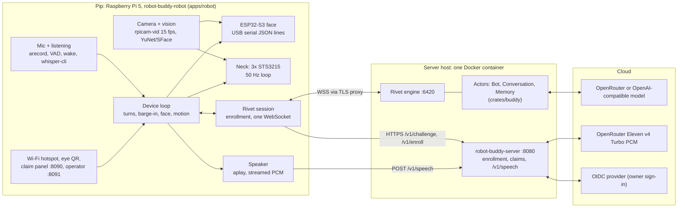

# Robot Buddy

Robot Buddy is the software for **Pip**, a 3D-printed desk robot with round LCD eyes, a three-joint neck, a camera and a voice. You say "Hey Pip" and talk to it. It is all Rust:

- **`robot-buddy-robot`** (`apps/robot`) runs on Pip's Raspberry Pi 5 as one systemd service. It owns the microphone, speaker, camera, ESP32-S3 face board and STS3215 neck servos, and talks to the server over one Rivet session.
- **`robot-buddy-server`** (`apps/server`) and the **Rivet engine** run on a separate host in one Docker container. Rivet actors (`crates/buddy`) hold identity, conversations and memory. [Rig](https://github.com/0xPlaygrounds/rig) runs the model and its tools.

The models are hosted. Inference uses OpenRouter by default, or any OpenAI-compatible endpoint you configure (`AI_PROVIDER=openai_compatible`, for example a local server). Spoken replies use OpenRouter's `elevenlabs/eleven-v4-turbo` and nothing else. Wake word, endpointing, transcription and face tracking all run locally on the Pi.

The Pip hardware port (branch `feat/pip-hardware`) passes in ARM64 containers with virtual peripherals. **It has not been run on a physical Pip yet.** [CHANGELOG.md](CHANGELOG.md) lists what is validated and what still needs a real robot.

## Architecture



How one turn works:

1. **Boot and enroll.** Pip signs a challenge with its device key. The server returns the Rivet endpoint and credentials, and Pip opens a Conversation WebSocket. Ownership checks and claims go to the Bot actor.
2. **Wake.** The mic beam is read through ALSA in 20 ms frames. The built-in energy VAD ends a clip after 800 ms of quiet. The optional neural wake (`hey_pip.onnx`) listens before transcription. Without it, an idle transcript that starts with "Hey Pip", "Hi Pip" or "Pip" wakes Pip.
3. **Speech in.** `whisper-cli` decodes on the Pi. Pip saves the text, then submits it. When Conversation acknowledges the new turn, Pip posts the turn ID to `/v1/speech` with `stream: true`. Microphone audio never leaves Pip.
4. **Think.** The Conversation actor runs a Rig agent, and the Memory actor supplies facts. The `express` tool sends a live `face.express` cue. It is never replayed.
5. **Speak and move.** The server streams Eleven v4 Turbo PCM to `aplay`. Camera gaze steers the eyes and the 50 Hz neck loop.
6. **Barge-in.** Neural wake can interrupt a reply (busy threshold 0.8 by default). Pip stops playback locally, then cancels the turn. Transcript wake cannot barge in.
7. **Recovery.** Pip reconnects with jittered backoff. After three consecutive failures it also checks the managed Wi-Fi link. Missed events replay by sequence without being spoken again. A rebooted face board has its mood, gaze and QR repainted.

Actor ownership: **Bot** owns identity and ownership, **Conversation** owns the transcript and the Rig run, and **Memory** owns facts. Details: [backend architecture](docs/architecture/backend.md), [robot client](docs/architecture/robot-client.md), [voice](docs/architecture/voice.md).

**Walkthrough.** An animated architecture walkthrough ("How one Pip turn works", with an MP4) exists outside this repo. The diagram and steps above match it and the code. The walkthrough shows only OpenRouter for inference. The code also accepts an OpenAI-compatible endpoint.

## butty and robot-buddy

Pip started as **butty**, ToschLogic's repository at <https://github.com/ToschLogic/butty> (Gage manages access). butty holds Pip's CAD, the ESP32-S3 face firmware, the wiring and the original Python brain. robot-buddy keeps butty's hardware and firmware and replaces the software on the Pi. Comparisons below are against butty at commit `c0ca680`.

| | butty | robot-buddy |
| --- | --- | --- |
| On-robot code | `brain/`, Python 3.11+, one systemd service `pip.service` | The Rust robot client `apps/robot` (`robot-buddy-robot`), one systemd service `robot-buddy.service` |
| Wake word | openWakeWord with a custom-trained "Hey Pip" model (`SPEC.md`). `brain/config.yaml` ships `wake_engine: transcript` and recommends openWakeWord on the Pi | Built-in energy VAD, then a whisper transcript that starts with "Hey Pip", "Hi Pip" or "Pip". Optional in-process neural wake: ONNX Runtime (loaded through `ORT_DYLIB_PATH`) runs the openWakeWord frontend and butty's `hey_pip.onnx`, Cargo feature `onnx-wake`. Only neural wake can barge in |
| Speech to text | Moonshine, with whisper.cpp as a fallback (`SPEC.md`). `brain/config.yaml` ships `stt: whispercpp` | Built-in energy VAD and whisper.cpp only, as a separate `whisper-cli` process |
| Thinking | LiteLLM, on the Pi. OpenAI Codex by default; Anthropic, Gemini and Ollama can be swapped in | A separate server: `robot-buddy-server` and Rivet actors (`crates/buddy`) running a [Rig](https://github.com/0xPlaygrounds/rig) agent. OpenRouter by default, or `AI_PROVIDER=openai_compatible` |
| Speech output | Piper, local, pitched up | OpenRouter `elevenlabs/eleven-v4-turbo`, streamed as PCM from the server's `/v1/speech` to `aplay`. Piper is used only for an optional fixed offline announcement, with butty's pitch-up coloring |
| Vision | picamera2 → OpenCV YuNet detection and SFace recognition, in Python | `rpicam-vid` → in-process OpenCV YuNet and optional SFace, Cargo feature `pi-vision` |
| Web page | Built-in stdlib HTTP server, key-protected, on `0.0.0.0:8080` by default: camera, log, controls, people, Wi-Fi setup | Loopback-only pages on the Pi: the claim panel (`127.0.0.1:8090`) and the token-protected operator console (`127.0.0.1:8091`, reached over an SSH tunnel). On the server, the optional `/lab` workbench |
| Face firmware | `firmware/` (PlatformIO, C++) | Uses butty's firmware unchanged, over the same JSON-lines protocol at 115200 ([DEPLOYMENT.md §4](DEPLOYMENT.md#face-and-neck)) |

Both run the neck at 50 Hz, show Wi-Fi setup QR codes on the eyes when offline, and keep face recognition on the device. Run only one of them: stop butty's `pip.service` before you install robot-buddy.

**Operating system.** Brittian's spec sheet and butty's `brain/README.md` name Raspberry Pi OS **Bookworm**. The robot binary that passed the 30-minute soak was built with the **Trixie** recipe, and the ARM64 toolchain matrix validated both Bookworm and Trixie ([evidence](infra/toolchain-validation.md)). A Trixie binary does not run on Bookworm. [DEPLOYMENT.md §2](DEPLOYMENT.md#2-build-the-linux-arm64-binary) says which binary to install for each, and how to check the soaked binary's SHA-256 (`be7cae4e42fda047f857d327af875e0dbf91b54af3a8076df84080e802e2768b`, GNU BuildID `c15c88b7594bd0919c5a0bf78609c2b01c6162e9`).

## Repository map

| Path | What it is |
| --- | --- |
| `apps/robot/` | `robot-buddy-robot`, the Pi device service: listening, vision, face, neck, speaker, Wi-Fi setup, panels, Rivet session |
| `apps/server/` | `robot-buddy-server`: `init`/`provision` CLI, enrollment, OIDC claims, `/v1/speech`, optional `/lab`. Spawns the Rivet engine |
| `crates/buddy/` | Shared crate: Bot/Conversation/Memory actors, Rig model and tools, wire protocol (`src/protocol.rs`), prompts |
| `tooling/rust-workspace/` | The one Turborepo package that wraps the Cargo workspace tasks |
| `infra/` | Pi systemd unit, `20-pip.conf` drop-in, polkit rule, `device.env.example`, Pi build image, ARM64 toolchain matrix and its evidence |
| `scripts/` | `check-all.mjs` (full local gate), `pip-perf.py` and helpers for on-device acoustic benchmarks |
| `tests/` | JS harnesses (integration, bench, reconnect, shutdown, lab, voice eval), the ARM64 E2E and soak harness (`pip-e2e/`), the systemd deployment rehearsal (`pip-deploy-qa/`) |
| `docs/` | Architecture, testing, performance, security, research and plans. Start at [docs/README.md](docs/README.md) |
| `Dockerfile`, `compose.yaml`, `compose.local.yaml` | Server and engine image, and the production and local-lab Compose files |
| `.github/workflows/ci.yml` | CI: check/lint/test, bench artifact check, cargo-deny, aarch64 type-check |

## Prerequisites

| Tool | Version | Source |
| --- | --- | --- |
| Rust | 1.100.0, with rustfmt and clippy | `rust-toolchain.toml` (rustup picks it up) |
| Bun | 1.4.4 | `package.json` `packageManager`; runs Turborepo and every test harness |
| Docker | with Compose. Buildx with `linux/arm64` for the Pi and E2E images | `Dockerfile`, `infra/pi-build.Dockerfile`, `tests/pip-e2e/Dockerfile` |
| Rivet engine | 3.1.1, `rivetdev/engine:3.1.1@sha256:55cdfe9a92c0ee2f7d3ce5f388dab2ef8e0be1bab8e3f1adb7ba972f862e25d4` | `Dockerfile`. The Rust crates `rivetkit`, `rivetkit-client` and `rivet-error` are pinned to `=3.1.1` in `Cargo.toml` |
| Rig | 0.46.0 | `Cargo.toml` |

A full-feature robot build (`pi-vision,onnx-wake`) also needs OpenCV 4.10 development files, libclang and pkg-config. See [DEPLOYMENT.md](DEPLOYMENT.md).

## Quickstart: server and Rivet engine

From the repository root:

```sh
bun install
bun run check                                     # type-check the workspace
umask 077
cargo run --locked -p robot-buddy-server -- init secrets   # writes secrets/issuer.key and secrets/secrets.env
cp .env.example .env && chmod 0600 .env
```

Copy the three values from `secrets/secrets.env` into `.env`, then fill in the rest. Use placeholders like these. Never commit real values:

```ini
BUDDY_SIGNING_KEY=<from secrets/secrets.env>
RIVET_TOKEN=<from secrets/secrets.env>
DEVICE_ISSUER_PUBLIC_KEY=<from secrets/secrets.env>
BUDDY_PUBLIC_URL=https://buddy.example.com          # registration origin, through your TLS proxy to :8080
BUDDY_PUBLIC_RIVET_URL=https://rivet.buddy.example.com  # Rivet origin incl. WebSockets, to :6420
AI_PROVIDER=openrouter                              # or openai_compatible
AI_API_KEY=<your-openrouter-key>                    # create it at https://openrouter.ai/keys
AI_MODEL=<model id, e.g. the validated z-ai/glm-5.3-flash:nitro>
TTS_MODEL=elevenlabs/eleven-v4-turbo                # optional; enables spoken replies, uses the OpenRouter key
OIDC_ISSUER=<https issuer URL>                      # optional; needed to claim a robot
OIDC_CLIENT_ID=<client id>
OIDC_CLIENT_SECRET=<client secret, omit for a public PKCE client>
```

Then start the container:

```sh
docker compose up --build -d
docker compose ps
curl --fail http://127.0.0.1:8080/ready
```

- **Ports.** `compose.yaml` binds 8080 (registration) and 6420 (Rivet HTTP and WebSocket) to localhost only. Put your own TLS reverse proxy in front. It must pass WebSockets through and must not log credentials or query strings. The image has no certificate manager and no identity provider.
- **Local model.** Set `AI_PROVIDER=openai_compatible` and `AI_BASE_URL`, for example `http://host.docker.internal:11434/v1`. Plain HTTP to a host other than loopback also needs `AI_ALLOW_PLAINTEXT_MODEL=1`. Use that only on a trusted private network. `AI_REASONING_EFFORT` works only with OpenRouter.
- **Loopback-only testing.** Set `BUDDY_PUBLIC_URL=http://127.0.0.1:8080`, `BUDDY_PUBLIC_RIVET_URL=http://127.0.0.1:6420` and `BUDDY_ALLOW_INSECURE_LOCAL=true`. Every other URL must be HTTPS.
- **External engine.** If `RIVET_ENDPOINT` points at an engine elsewhere, it must be HTTPS. The one exception is plain HTTP to the host named in `RIVET_ENDPOINT_PLAINTEXT_HOST`, such as a private Docker-network service name.
- **Storage.** The named volume at `/data` holds engine logs and object data. Only one engine may use it. Stop the container before you back it up, and keep the server secrets with the backup. S3 is optional (see `.env.example`). See [storage and recovery](docs/architecture/backend.md).
- **Issuer key.** `secrets/issuer.key` signs device identities. Keep it offline. It is never mounted into the server.

Every variable is described in [.env.example](.env.example). To try a robot without hardware, run `cargo run -p robot-buddy-robot -- --simulate`. It reads text or JSON control lines on stdin. For the browser workbench, see [docs/lab.md](docs/lab.md) (`bun run dev:lab`).

## Bring up a real Pip

Follow **[DEPLOYMENT.md](DEPLOYMENT.md)** from top to bottom. It covers the hardware and wiring, face firmware, getting the ARM64 binary (including the exact soaked ELF), models and checksums, systemd install, enrollment and the OIDC claim, the bring-up checklist with pass thresholds, troubleshooting and rollback.

Before you start, read [DEPLOYMENT.md §0](DEPLOYMENT.md#0-what-you-need-before-you-start). It lists what comes from your butty checkout (face firmware, `hey_pip.onnx`, hardware reference), what you create yourself (an OpenRouter key at <https://openrouter.ai/keys>, in `AI_API_KEY`), what Gage must get from Brittian (OIDC client credentials; server hosting, domain and TLS access; a Brave Search key if Brittian holds one), and the open "Check with Brittian" items.

## More

- [docs/README.md](docs/README.md): index of every doc
- [AGENTS.md](AGENTS.md): rules and commands for contributors and coding agents (tests, `check:all`, E2E, soak, ARM64 matrix, bench)
- [NOTICE.md](NOTICE.md): provenance (ToschLogic's butty) and third-party licences
- [CHANGELOG.md](CHANGELOG.md): what the Pip port changed and its validation status
- [LICENSE](LICENSE): MIT, for this repository's own code only. See NOTICE.md for the rest
