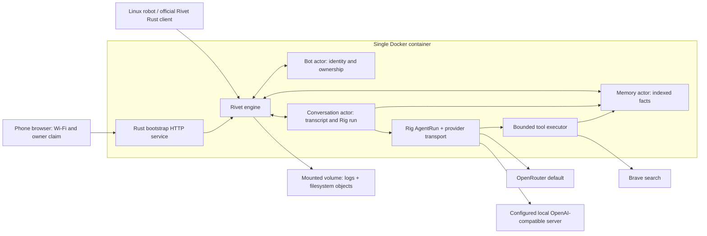
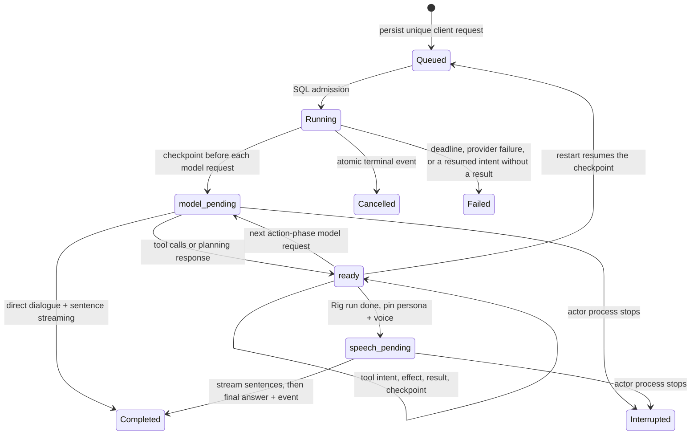

# Implemented backend architecture

The backend application and robot client are Rust. Versions are pinned in Cargo.lock and Dockerfile. Rig drives model/tool sequencing; Rivet owns persistence and actor lifecycle. The robot owns microphone/speaker/camera/actuator integration. AgentOS and a general-purpose agent filesystem are not needed for the implemented tools.

## Ownership

| Actor | Key | Durable state |
|---|---|---|
| Bot | Stable hash of provisioned device ID | Device key binding, revocation, owner, pending QR claim, consumed enrollment nonces |
| Conversation | Bot ID (one conversation per robot initially) | Turns, deduplication IDs, tool intents/results, ordered events, versioned Rig checkpoint, bounded persona library and voice/location settings |
| Memory | Bot ID | Explicit facts and SQLite FTS5 search index |

Bot does not run inference or hold transcripts. Memory has an independent mutation boundary. Conversation keeps its turn and transcript together, avoiding distributed commit for each token. Actor fields hold reusable clients and transient synchronization only. SQL transactions and unique constraints govern concurrent admission; an actor does not imply serialized asynchronous actions.

## Rig execution and recovery

The checkpoint `phase` column holds `model_pending`, `ready` or `speech_pending`. There is no separate tool phase: a tool intent is a `tool_calls` row without a result, written while the run is `ready`.

`AgentRun` is checkpointed at effect boundaries, not on every token. Snapshots carry a Rig-format version and are limited to 512 KiB. Completed/failed run checkpoints are deleted after their terminal event commits; canonical history and tool receipts remain. Unsupported checkpoint versions fail explicitly.

A restarted pending model request is interrupted, preserving committed output events; it is not automatically repeated. A ready checkpoint resumes. The `speech_pending` checkpoint interrupts after restart; spoken output is never regenerated automatically. A completed tool receipt is reused. An intent without a result fails closed because the effect may have happened. This is not an exactly-once claim for external services. Model calls have a 90-second deadline, a run has a 180-second execution deadline, and Rig permits eight action-phase model rounds with at most eight calls per round, followed by one tool-disabled spoken model call when tools require it. Ordinary dialogue completes in the first call. Recovery at a ready boundary resets the execution deadline; model-turn count remains in Rig state.

Terminal status and terminal event commit in one transaction. Failed, interrupted and cancelled turns retain committed partial text in history. Event and checkpoint writes require running status, and snapshot reads include an atomic replay cursor. Cancellation is idempotent and cannot relabel a completed turn. WebSocket events are hints; clients replay the durable sequence log. The robot persists an unacknowledged submission ID before sending and resends the same request after reconnect. Output consumption is at-least-once around a device crash: hardware speech playback needs its own acknowledgement policy.

## Context and performance

Normal prompts load the latest 12 completed turns (bounded text, read through the `turns_completed` index), up to six matching facts plus two recent facts, and the current request. Full transcript data stays in SQLite and is accessible via history pages and an FTS5 history-search tool. This provides bounded normal context cost; lexical retrieval is not semantic search or a promise that every relevant fact is automatically retrieved. Tool receipts retain tool arguments/results separately from the final spoken answer.

Rig uses a shared pooled HTTP transport with redirects disabled and connect/total deadlines; the web-search client is reused. A model stream that sends nothing for 30 s fails its turn. Streaming uses a bounded channel. Text between sentence boundaries commits at most 200 ms after the previous commit, and only while text is waiting; an idle stream wakes once a second for the stop and access check and runs no SQL. Actor lookup is not performed per token.

Model endpoints. An `openai_compatible` `AI_BASE_URL` must use `https` unless its host is `localhost` or a loopback address. `AI_ALLOW_PLAINTEXT_MODEL=1` allows plain HTTP to another host, for a model on a trusted private network only. Startup fails otherwise.

Revocation. Every device action except `SpeechChunk`, and every connect, asks the Bot actor fresh, so a revoke fails them at once. Four checks may reuse a check that passed in the last second: speech chunk polling, a subscription right after its connect, and the generation and delivery checks of a running turn. A revoke therefore stops a running turn and its speech within about one second. The cache dates from when the passing check began and is cleared by any failed check. The memory actor checks every call fresh: its agent calls in one turn are seconds apart, so a one-second cache would not save a check.

Delivery. Output events go only to connections subscribed to `output`. Each connection's session is verified once and its expiry cached. A connection whose session has expired is disconnected before the event is sent. If that disconnect fails and the connection is still open, the event is not broadcast: it goes one by one to the valid connections this process saw subscribe, and the others catch up through `Replay`. A failed revocation check disconnects every connection.

A process-wide inference semaphore defaults to 16 concurrent model calls and rejects overflow; no global actor is involved. Every turn checks access with the Bot actor and searches the Memory actor, so both sleep after 5 minutes idle instead of rivetkit's 30 s default; Conversation keeps the default. A connected robot checks its registration with the Bot actor every 3 s until it is owned, then every 5 minutes (`REGISTER_UNOWNED`, `REGISTER_OWNED` in `apps/robot/src/device.rs`), so an owned, idle robot wakes the Bot actor rarely.

Retention. The newest 50 turns keep their event log, speech chunks, pinned voice and tool receipts. Older turns keep their record, answer and history search row. After every 8 finished turns a background pass deletes older rows in bounded batches (2,048 events and 512 rows of each other table per transaction). It never touches a queued or running turn or anything newer. A `Replay` cursor older than the window continues from the oldest kept event. A pruned turn has no chunks, so a speech poll for it reads `done` and nothing old is spoken again; `SpokenAnswer` still returns its answer, in the current voice.

Do not claim throughput improvements without measurement. SQLite statements and transactions per turn are measured by `tests/core_sql_counts.rs` (see `docs/research/benchmarks.md`). First-token latency, checkpoint bytes, event bytes, memory per active run and idle wakeups still need release-build baselines before batching or context limits change. Semantic memory, summarization and multi-conversation indexing are future extensions.

## Enrollment and storage

A provisioned Ed25519 key proves possession of an issuer-signed device identity. The server signs a short-lived challenge; its nonce is consumed in the Bot actor. A deterministic bot ID recovers the same actors even when the robot cache is lost. Scoped engine tokens grant access to exactly the bot, conversation and memory actor IDs; application sessions additionally bind bot, role and expiry. OIDC authorization-code/PKCE, a signed ID token validated against issuer JWKS, nonce/audience/expiry checks and matching userinfo bind an owner, followed by physical confirmation. There is no shared factory credential.

The container runs server and engine under a non-root user with graceful shutdown supervision. Both `storage.log_directory` and `object_storage.primary.file_system.path` are mounted under `/data`; no S3 is required for this single-process topology. Never use an in-memory object backend for restart persistence. Never run two engines on the same directory or place log storage on NFS/EFS.

Rivet documents filesystem objects for single-machine/quickstart use and recommends external object storage for production. Optional S3 settings are available without changing actor code. A single container remains one failure domain even with S3; high availability requires a different deployment. Sources: [storage](https://rivet.dev/docs/deploy/self-host/control-plane/storage/), [Rig release](https://github.com/0xPlaygrounds/rig/releases/tag/v0.46.0).

## Early speech boundary

The initial request can stream response-text dialogue directly, completing in one call. Tool/planning prose produces no user-visible text. After tools finish, Conversation pins persona and voice in a transaction and starts a tool-disabled response phase. Its deltas commit transcript text before sentence chunks. Clients react to `speech.ready` (with a snapshot fallback), then consume one authenticated PCM stream from the server. Sentence text/configuration are durable actor data; audio remains transient. See [voice delivery](voice.md).

## Streaming and cancellation

The provider runs on its own task. It feeds a bounded channel of 16 deltas. Storage writes never block it from reading the network.

At each sentence boundary, one transaction commits the pending `text.delta`, the speech chunk and its `speech.ready`. Every insert is guarded on the running turn. Events are delivered after the commit. Replay order is unchanged: text first, then each chunk and its ready event.

Each running turn has an in-process stop signal. A terminal cancel or failure fires it after its transaction commits; so do the 180 s turn deadline and actor shutdown. The stream consumer then returns at once and the provider task is aborted, which closes the provider connection. Memory and web search calls of a tool stop with it too, leaving their intent without a result. The consumer handles each wake-up after `select!` returns, so no SQLite transaction is dropped mid-flight. A turn gets 2 s to reach its next stop check after the deadline or shutdown; only a turn stuck past that is dropped. Durable turn status stays the source of truth. Checkpoints, tool intents and chunk writes use `RETURNING` and fail with "turn cancelled" on zero rows.

If marking a turn failed fails, it is retried three times. If all fail, the next drain marks every running turn failed before it claims. A failed drain is retried after 100 ms, doubling, five times; a later submit starts a new drain even while the bot is busy.

The claim is one transaction: it marks the turn running, commits `turn.started`, and reads the saved run, the system prompt and recent turns (a fresh run) or the completed tool calls and spoken bytes (a resumed run), and the runtime context. Rows are parsed after the commit, so a bad row fails the turn instead of leaving it queued. The memory search follows, then the `model_pending` checkpoint commits before the request is sent. Later rounds keep the completed tool calls and spoken bytes in memory. If the provider fails mid-stream, text not yet committed is committed first, so the failed turn keeps what was said. The spoken phase pins the voice while context and facts load. The pinned voice holds the chosen voice only, not the voice catalog.

`Replay` pages hold at most 128 events and 512 KiB of payload, counting 64 bytes per event, half of rivetkit's 1 MiB message limit. A page always holds at least one event, even one larger than the budget, and clients page until a page is empty.

One model call may stream 128 KiB of text and 256 KiB in total. The total counts reasoning, tool arguments and unknown provider payloads. Reasoning is counted and dropped, never forwarded.

## Sentence splitting

The splitter keeps a cursor and scans each byte once. A boundary is decided only when the next character arrives, so token fragmentation never changes the output. Chunks concatenate back to the exact model text. Whitespace after a boundary stays with the chunk it ends; whitespace-only chunks are not spoken.

- `!` and `?` end a sentence before whitespace. CJK terminators always do.
- Runs like `?!` and closing quotes or brackets stay with their sentence.
- `.` and ellipses end a sentence before whitespace, unless the next word is lower case.
- Listed abbreviations, initials, dotted abbreviations, list numbers and `3.14` or `example.com` do not split.
- A newline ends a chunk.
- The first chunk may end early at `,` `;` `:` or `—` plus whitespace once it holds 24 bytes.
- Unpunctuated text breaks at whitespace after 240 bytes and anywhere after 600.

If the stream stalls for 200 ms on an undecided sentence end, the harness decides it as a boundary. Only that case depends on timing.

## History search storage

`history_rows` maps each turn to a stable FTS row ID. The insert and answer triggers write a turn's search row at that ID with `INSERT OR REPLACE`, a keyed write. Version 1 deleted by the unindexed `turn_id` column, a full scan of the index for every finished turn. The schema script is idempotent and never changes `turns`.

A version 1 database is rebuilt in batches by `conversation/history.rs`:

1. `create` runs one start transaction. It drops the version 1 triggers, records a floor (the highest FTS row ID in use) in `history_backfill` and places a sentinel mapping at floor + 1, so every new row ID lands above the floor.
2. A background task started in `on_start` runs one transaction per batch of 256 turns, in turn ID order. Each batch maps its turns above the floor, writes their search rows and advances the cursor.
3. When every turn is mapped, sweep batches delete 256 leftover rows at or below the floor per transaction. The last one removes the progress row and the sentinel and writes the `history_search_rowids` marker.

A stop between or inside batches loses nothing. An uncommitted batch rolls back, and the next start resumes from the committed cursor. Replaying a committed batch writes nothing.

Search stays exact during the rebuild. It reads a turn's mapped row, or its version 1 row below the floor while the turn is still unmapped, so each turn appears once. A turn that finishes mid-rebuild is mapped by its trigger at once.

Rolling deploys. Version 1 code that opens the database again recreates its triggers. Its writes still succeed, since the current triggers use `INSERT OR IGNORE` and `INSERT OR REPLACE`. Its own search can show a turn twice: once for the version 1 row and once for the mapped row. The current search hides rows written by version 1. The next start of the current code finds the version 1 triggers and restarts the rebuild above a new floor, which sweeps those rows too.

At 5,000 turns, `tests/history_sql.rs` measured 42 batches. The largest wrote 84 pages, against Rivet's limit of 32,768 pages per transaction. The one-shot rebuild it replaced wrote 260 pages at that size, and its size grows with history. Method: a WAL file with automatic checkpoints off. The test truncates the WAL before each batch, and after the commit counts the WAL frames, one per 4 KiB page written.

## SQLite practices

Rivet references: [SQLite](https://rivet.dev/actors/docs/sqlite/), [Limits](https://rivet.dev/actors/docs/limits/), [SQLite profiling](https://rivet.dev/actors/docs/sqlite-profiling/).

- Every statement goes through `db::Db::db`, which counts statements, auto-commit statements and transactions per process. `tests/core_sql_counts.rs` reads those counts around real turns.
- Every transaction has a static name, such as `conversation.finish_turn` or `conversation.history_backfill`. Names appear in Rivet errors and profiles.
- Ordinary transactions time out after 10 s (`db::named`); history rebuild and retention batches after 30 s (`db::named_for`). Each holds a few local statements, so a longer hold means something is wrong.
- Transaction callbacks await only the transaction handle. Actor calls, provider requests and event delivery happen before or after the commit.
- A read followed by a write either runs in one transaction or is one guarded statement. Examples are the turn claim, the claim confirmation and its failure counter, the facts cap, settings revisions, a tool's persona activation and the factory persona adoption.
- Work that grows with history runs in bounded batches, never in one transaction: the history search rebuild and retention. Limits: 32,768 pages (128 MiB) per transaction, a 60 s default timeout, and a queue of 128 transactions.
- Schema changes run in `create`, before any action. The claim failures column is added only after a check that it is missing, and the check runs again if the add fails.
- A Conversation wake skips `conversation.sql`, the settings seeds and factory adoption when `PRAGMA user_version` is at least 1 and no older history trigger exists. Code before this version never sets it and always runs the full, idempotent path, so a rolling deploy works in both directions. A unit test pins the schema file's hash to the version: a schema change must raise both.

Building `turns_completed` on a history that predates it is one statement in one transaction. `tests/core_index_cost.rs` measured the pages it writes:

| Turns | Pages written | Share of the 32,768-page limit | Seconds (in-memory) |
|---|---|---|---|
| 5,000 | 79 | 0.2% | 0.001 |
| 50,000 | 776 | 2.4% | 0.071 |
| 100,000 | 1,557 | 4.8% | 0.062 |
| 500,000 | 7,815 | 23.8% | 1.6 |
| 1,000,000 | 15,635 | 47.7% | 1.5 |

The cost is about 15.6 pages per 1,000 turns, so one transaction holds the build up to about 2.1 million turns. The supported size is 1 million turns, which the test asserts. Retention keeps every turn record, so history still grows with use: at 200 turns a day, 1 million turns is about 13 years. Only a database created before the index needs the build, once.

Profiling needs rivetkit's `sqlite-local` feature. This build uses the default `sqlite` feature (`sqlite-remote`), so `RIVETKIT_SQLITE_PROFILING` and the `rivet_rivetkit_sqlite_*` metrics do nothing here. To profile locally:

1. Build `rivetkit` with `default-features = false, features = ["sqlite-local"]`.
2. Set `RIVETKIT_SQLITE_PROFILING='{}'`. An empty object profiles every query. `filterQueries` and `filterQueryFingerprints` narrow it.
3. Read the "sampled SQLite operation profile" and "sqlite fingerprint catalog" log lines, and the `rivet_rivetkit_sqlite_*` Prometheus series.

The fingerprint catalog keeps 512 statements but only 8 transactions per process. Profile one actor type at a time, through `ActorConfig.sqlite_profiling`. The wrapper counts work in every build.
