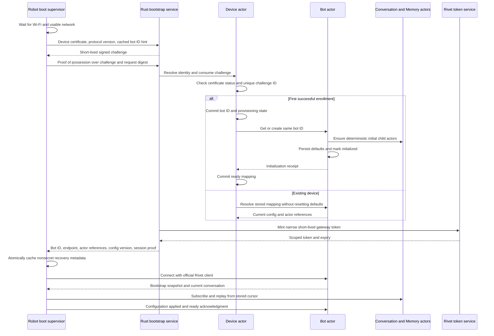

# Automatic boot, registration and reconnection

Implementation scope: see [implemented backend](backend.md) and [acceptance status](../plans/implementation.md). This document includes future reset, transfer and recovery features beyond the current core.

Status: proposed protocol and actor design. User requirement: after Wi-Fi connects, a new robot automatically creates its bot and configures itself; an existing robot reconnects to its stored bot ID. Most state lives in Rivet actors.

## Experience

Power on → connect to known Wi-Fi → authenticate the device → create or recover the bot → synchronize configuration → resume the conversation → ready.

No user-facing backend URL, API key, bot-ID entry or registration form. On the first successful boot the robot can say “I'm ready.” During subsequent boots it resumes its own personality, settings and memory. It reports “Connecting” while unavailable, never pretends a server action succeeded offline. Wi-Fi onboarding itself belongs to the robot application; the backend flow starts once network access exists.

The backend is authoritative for identity mapping and configuration. A cached bot ID speeds recovery but does not prove identity. Losing the bot-ID cache must not create a second bot.

## Identity and trust established before first boot

Each robot is provisioned during assembly/development with a unique device keypair and a manufacturer/development-issuer signed certificate binding its public key to a stable device ID. Prefer a secure element; otherwise protected OS storage with a documented threat model. The flash/provisioning tool is a developer/manufacturing task, never an end-user setup step. Do not ship a shared fleet secret or Rivet admin token.

The firmware contains a stable bootstrap URL and trusted TLS roots. A valid certificate plus proof of key possession authorizes automatic enrollment. A serial number, MAC address or random ID alone does not. For hand-built prototypes, generate a unique credential when preparing the SD card/image; never clone the same identity onto every device.

This manufacturing identity is a proposed prerequisite, not a verified existing hardware feature. If hardware cannot protect keys, the backend can still prevent accidental duplication but cannot distinguish a fully cloned device credential from the original.

## Actors and identifiers

| Identifier / actor | Role |
|---|---|
| `device_id` | Stable issuer-bound physical-device identity, independent of Wi-Fi or account |
| Device actor keyed by environment + issuer + device ID | Canonical credential status, current bot mapping, enrollment steps, revocation and active session epoch |
| `bot_id` | Stable application ID assigned once and committed in Device actor before creating child actors |
| Bot actor keyed by bot ID | Personality, configuration, lifecycle, owner/claim status, current conversation and child references |
| Conversation actor keyed by bot ID + conversation ID | Transcript, turns, model/tool execution, replay cursor |
| Memory actor keyed by bot ID + scope | Bot-local memory by default; person-specific scopes only after identity/ownership is established |
| Schedule actor keyed by bot ID + schedule ID | Durable reminders and delivery receipts |
| `actor_id` | Rivet routing ID resolved by backend; may differ from the stable application bot ID |

There is no fleet-wide actor on every heartbeat. One Device actor per identity provides uniqueness without a global bottleneck. Server-side get-or-create resolves that actor; the robot never receives general actor-creation permission.

## First boot sequence

Bootstrap is a small Rust HTTPS identity/token exchange, not another conversation transport. It exists because an uninitialized robot cannot safely hold the engine administration credential needed to create actors and mint scoped tokens. All bot operations, registration state, configuration, conversation and events use Rivet actors and the official Rivet client. The bootstrap service itself is stateless apart from transient request handling; signing/admin keys come from secret management.

Challenge flow: the server signs an expiring random nonce bound to device ID, public key, environment, protocol and request digest. The device signs that challenge. The Device actor atomically consumes its nonce and records the enrollment request result; retries with the same authenticated request recover the same mapping. Expired nonces cannot start work. Replayed valid proofs cannot create another bot. Keep nonce retention bounded by validity plus clock skew. TLS remains required.

Do not rely solely on tokens' gateway grants for application identity. Return a separate short-lived application session assertion binding device ID, bot ID and session epoch, then verify it in actor connection/action/subscription authorization. The Rivet token grants reachability to exact resolved actor IDs only. Confirm the SDK's token plumbing in phase 0; the final field names depend on the supported client API.

## Idempotent provisioning

Device actor states: `new → provisioning → ready`, with independent `revoked` and `decommissioned` terminal policy states. Bot actor initialization has a schema/defaults version and an explicit completion marker.

1. In a Device actor SQL transaction, persist one bot ID and initialization generation using a unique device identity. Concurrent boot requests observe the same winner.
2. Resolve/create the Bot actor using that persisted ID. Do not allocate another ID after timeout.
3. The Bot actor commits references/initialization intents before ensuring deterministic child actors. If a create response is ambiguous, inspect its returned actor ID or reconcile the same key; never issue blind unrelated creates.
4. Record receipts and advance phases only after required steps complete. Wakeups/retries repeat only unfinished idempotent steps.
5. Issue a usable connection bundle only after the bot is ready. If token issuance fails, retry token issuance without recreating anything.

This is a reconciled multi-actor protocol, not a distributed SQL transaction. Interrupted enrollment must converge on the same bot and the same initial conversation. The server can complete provisioning after the client disconnects; the next boot discovers the result.

## Configuration and ownership

The Bot actor stores model policy, personality, enabled tools, capabilities, locale, retention policy and active conversation. On first enrollment it copies a versioned server default profile: OpenRouter, a configured model, bounded search/memory tools and conservative spending limits. Required server provider secrets must already be configured by the operator; a robot never receives them.

Configuration is revisioned. The robot applies a complete snapshot atomically and acknowledges its revision. Local hardware facts such as microphone/camera availability are reported capabilities, not authority to enable every tool. The server returns the intersection of hardware support, firmware compatibility and policy.

Implemented owner claim: on a headless robot, onboarding starts with the printed setup card (`robot-buddy-robot setup-card`) for the hotspot; the loopback face panel (`BUDDY_SCREEN_ADDR`, default `127.0.0.1:8090`, or `off`) is optional. Once online, the robot shows (or logs) a QR for `GET /claim?bot&token`. That page sets a signed `HttpOnly` cookie bound to the bot, a digest of the token and a CSRF value. `POST /login` requires a same-origin `Origin`, the cookie and the matching form value, then redirects to the IdP with separate random `state` and `nonce`. After the ID token and userinfo check, the Bot actor stores a pending owner and a uniform six-digit code. The owner confirms by speaking the code (STT sends `{"confirm":"<code>"}` on the control socket) or pressing confirm on the optional panel. Five wrong codes clear the pending claim and its token; the robot starts a new claim once its cached claim expiry passes. The face panel rotates its CSRF token with each new code. Controls and tests: [security](../security.md).

Unclaimed bots may become ready immediately with bot-local memory and limited service budgets. Account claim is optional for the first demo, but required for personal email/calendar, shared person memory or remote ownership controls. Claim requires authenticated user identity plus proof of physical possession; knowing a bot ID is insufficient. Ownership transfer rotates authorization and explicitly clears or quarantines previous personal state before the new owner can access it. Do not automatically attach an anonymous voice speaker to a named person's memory.

## Reconnect and token renewal

On boot, authenticate with the stable device credential, offer the cached bot ID as a hint, and accept the server's canonical mapping. Fetch a config snapshot, then reconnect through the official Rivet client to the existing actors. Cache device identity, bot ID, protocol/config revisions and event/speech cursors; all are either credentials or rebuildable local state.

Refresh short-lived tokens ahead of expiry with jitter. Network reconnect reuses valid grants when possible; otherwise repeat authenticated bootstrap. Rotating a device key requires proof from the old key or an authenticated recovery process and preserves the stable device ID/bot mapping. Device actor revocation/ownership epoch is checked on privileged operations, with explicit propagation/invalidation for already-connected actors; short token TTL alone is not immediate revocation.

Use a server-issued session epoch so stale connections cannot publish current-device acknowledgments or execute robot commands. A new authenticated boot can supersede an older session according to policy. If credentials are cloned, simultaneous-session detection flags the conflict; it does not solve physical identity cryptographically.

## Failure behavior

| Condition | Required behavior |
|---|---|
| No Wi-Fi, DNS or captive portal | Stay local; retry with bounded backoff; no bot creation attempts before usable TLS connectivity |
| Backend temporarily unavailable | Retain identity/cache; reconnect with jitter; never create a replacement bot locally |
| Response lost after creation | Repeat authenticated bootstrap; recover the existing mapping |
| Cache missing or corrupted | Recover mapping from device identity |
| Cached bot ID belongs to another device | Ignore/reject hint; never transfer ownership |
| Firmware unsupported | Return explicit update-required status and safe limited behavior |
| Local model unreachable | Surface model-unavailable or use explicitly permitted fallback; no unauthorized cloud escape |
| Credentials revoked | Refuse connection/renewal; do not auto-enroll as a new device |
| Bot deleted/decommissioned | Retain Device actor tombstone; do not recreate on ordinary boot |
| Intentional factory reset | Distinguish clearing local cache from deleting cloud bot; destructive cloud reset requires authenticated intent |
| Physical key erased | Require reprovisioning or owner-assisted recovery; do not silently inherit private state by serial number |

## State placement

| On robot | On Rivet actors | Infrastructure secrets |
|---|---|---|
| Device private key and certificate | Device → bot mapping and credential revocation | Manufacturer public trust roots/revocation policy |
| Wi-Fi settings | Bot profile/configuration and ownership | Bootstrap signing key |
| Cached bot ID and endpoint | Conversations, memory, schedules and tool receipts | Rivet administration credential |
| Applied config version and playback cursor | Provisioning progress, session epochs and event replay | Model/search provider keys |
| Local hardware control/safety state | Audit events and configuration history | Storage service credentials |

## Acceptance tests

- Brand-new device becomes ready without a human backend setup step after Wi-Fi connects.
- Ten concurrent identical enrollment attempts create one bot and one initial conversation.
- Kill bootstrap/application node after every provisioning phase; retry converges to the same IDs.
- Reboot, erase only cache, change network and rotate tokens; bot ID, memory and conversation remain unchanged.
- Replay a challenge, forge a certificate, use another bot ID, clone credentials and revoke an active session; each has explicit tested behavior.
- Decommission then reboot does not resurrect private state or allocate a fresh bot.
- Apply config update while reconnecting; the robot acknowledges one complete revision.
- A second physical robot gets its own bot and cannot read the first robot's memory.

Sources: [Rivet scoped tokens](https://rivet.dev/docs/jwt/), [actor authentication](https://rivet.dev/actors/docs/authentication/), [get-or-create semantics](https://rivet.dev/docs/api/actors/get-or-create/), [Rust client](https://rivet.dev/actors/docs/clients/rust/). Device enrollment and recovery are application protocols proposed here, not built-in Rivet features.
