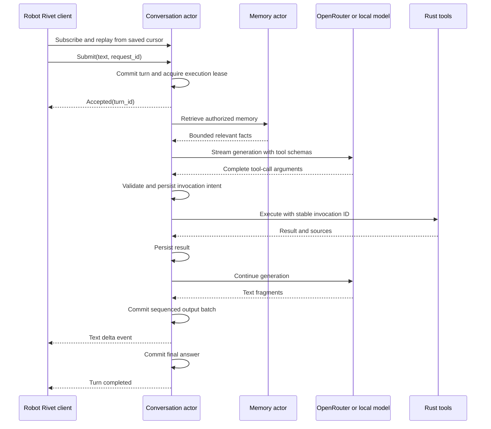

# Robot client contract

The wire contract is `crates/buddy/src/protocol.rs`; [implemented backend](backend.md) describes server behavior. The first part of this page describes the Linux device client in `apps/robot` as built. The second part, "Design targets", is the broader proposed protocol and is not all implemented.

## Implemented: Linux device client (`apps/robot`)

Target hardware is the "Pip" robot: Raspberry Pi 5 (8 GB, Raspberry Pi OS Bookworm, aarch64), ESP32-S3 face board on USB serial, microphone ring array with a local wake word and speech-to-text, and a MAX98357A I2S amplifier played through ALSA. None of this was tested on that hardware. Validation so far is unit tests and local fakes (see "Validation").

| Module | Role |
|---|---|
| `main.rs` | Settings, identity, reconnect loop with backoff, Wi-Fi recovery, SIGTERM flush |
| `session.rs` | Bootstrap, Rivet actor handles (untyped `rivetkit-client`), owner registration, the session loop |
| `controller.rs` | Event order, barge-in, early speech, face state (transport-free, unit tested) |
| `cache.rs` | Durable cache and its single ordered writer |
| `input.rs` | Control input on stdin |
| `face.rs` | ESP32 face bridge |
| `audio.rs` | `/v1/speech` playback through `aplay` |
| `screen.rs` | Loopback HTML panel on 127.0.0.1:8090 (QR codes, owner confirmation) |
| `wifi.rs` | SoftAP setup through NetworkManager |

The robot links `robot-buddy` with `default-features = false`: the wire types only, without the actor server, Rig or `rivetkit-core`. It calls the `call` action and reads the `output` event through the untyped `rivetkit-client`. The JSON is the same as the typed client sends: one argument holding the serialized `Call`, and one argument holding the `OutputEvent`. Unit tests in `session.rs` pin both shapes.

### Control input (stdin)

One line per command, at most 8 KiB. Longer lines are discarded through their newline. Invalid lines are rejected locally with a warning that never includes the line text. A closed stdin disables input; the robot keeps running.

| Line | Meaning |
|---|---|
| any line not starting with `{` | A finalized utterance (backward compatible) |
| `{"say":"<utterance>"}` | A finalized utterance |
| `{"wake":true}` | Wake word: stop playback now, cancel the live turn, face shows listening |
| `{"listening":true}` / `{"listening":false}` | Show or clear listening without an utterance |
| `{"mute":true}` / `{"mute":false}` | Mute stops playback, shows the muted LED and suppresses automatic speech |

A line starting with `{` is always a command, never an utterance. A JSON object must have exactly one of these keys. Utterances are trimmed and must be non-empty without control characters other than tab. Mute lives in memory; the speech front end should send its mute state again after the service restarts.

Every utterance replaces the turn in progress. The order is fixed: kill the player, write the cancel and the new utterance to the cache with fsync, cancel the old turn, then submit. After a disconnect the robot resends both: cancelling a finished turn is harmless and the request ID deduplicates the submission. If the server still reports a running turn the robot does not know (for example from before a reboot), it cancels open turns whose text differs from the new utterance and submits again.

### Events and the cursor

The subscription pushes each event into a bounded channel. The next sequence (`cursor + 1`) applies directly. Already-applied sequences are ignored. A gap, a full channel, or 2 s (live turn) / 10 s (idle) without pushes triggers `Replay`, one page per loop pass so input is serviced between pages.

The cursor is at least once. A single writer task coalesces checkpoints to one write per second, writes at once on a terminal turn event and on SIGTERM, and confirms the cancel/utterance record before any network call. Each write is temp file, fsync, rename, fsync of the directory. Re-applied events are deduplicated, and replayed turns never speak.

stdout gets one line per event. In hardware mode the line is `event sequence=<n> turn=<id> kind=<kind>`, with no user or assistant text. `--simulate` or `BUDDY_EVENTS=full` prints the full event JSON.

### Speech

The robot requests `/v1/speech` as soon as a submit is acknowledged as a new turn. The server holds the request until chunk 0 exists and replaces an older request for the same bot. Deduplicated submissions and replayed history never auto-play. If the early request ends with no audio, `speech.ready` index 0 starts one retry.

One pooled HTTP client (keepalive, HTTP/2 when the server offers it) serves all speech requests, warmed with `GET /health` at session start. Stopping speech drops an HTTP/1.1 stream, so the robot warms a new connection right after. Bootstrap uses a separate client.

`aplay` gets `--buffer-time=$BUDDY_ALSA_BUFFER_US` (default 120000 µs) and `-D $BUDDY_ALSA_DEVICE` when set (for example `plughw:CARD=sndrpihifiberry,DEV=0`). A smaller buffer stops sooner on barge-in; a larger one survives CPU stalls without underruns. Measure on the device before changing it. Each write to the player and its stdin shutdown has a 2 s progress deadline; a stuck player is killed and reaped. Stop kills the player instead of letting it drain. A player that exits early ends playback. Time to first PCM byte is logged at debug level (`RUST_LOG=robot_buddy_robot=debug`). A failing playback never ends the session.

### ESP32 face

Set `BUDDY_FACE_SERIAL=/dev/ttyACM0` to enable it. The robot opens the device for writing (it never creates the path) and writes one compact JSON object per line: `{"led":"<led>"}`, `{"e":"<expression>","i":<0..1>}` and `{"look":[x,y]}`. The serial line settings come from `stty` in the systemd unit, not from this program.

| State | When | LED | Expression |
|---|---|---|---|
| Offline | Not connected | `idle` | `sleepy` 0.5 |
| Idle | Connected, nothing to do | `idle` | `neutral` 0.5 |
| Listening | After `wake` until an utterance or `listening:false` | `listening` | `listening` 0.8, look `[0,0]` |
| Thinking | After submit until the first PCM byte | `thinking` | `thinking` 0.6 |
| Speaking | First PCM byte written until the player exits | `speaking` | `happy` 0.7, look `[0,0]` |
| Muted | Muted | `muted` | `neutral` 0.3 |
| Sorry | 1.5 s after a failed or interrupted turn | `idle` | `sad` 0.6 |

Expressions used: neutral, happy, thinking, listening, sad, sleepy. Changes go out at once; the current state is re-sent every 1.5 s, inside the ESP32's 5 s fallback. Writes run on their own task with a 500 ms deadline. Only the latest state is kept. If the device disappears (USB re-enumeration), the writer reopens it every second.

### Reconnect and Wi-Fi

Reconnects use exponential backoff from 1 s to 30 s with jitter (a random delay in the upper half of each step). Only a session that lasted 30 s resets it. After three unhealthy attempts in a row the robot checks the Wi-Fi link on each attempt. If no network has been joined for `BUDDY_WIFI_GRACE_SECS` (default 300), it reopens the setup hotspot for 10 minutes, then removes it so NetworkManager can rejoin a known network. `nmcli` runs without a shell, one argument per value, with a 45 s deadline and `kill_on_drop`. SSIDs are 1–32 bytes without control characters; passwords are 8–63 printable ASCII characters. A failure to restore the setup hotspot is logged and shown on the panel.

### Environment

| Variable | Default | Purpose |
|---|---|---|
| `BUDDY_SERVER_URL`, `BUDDY_IDENTITY_FILE` | required | Server and device identity |
| `BUDDY_CACHE_FILE` | `/var/lib/robot-buddy/cache.json` | Cursor, pending utterance, claim URL |
| `BUDDY_SPEECH` | off | `true` enables playback |
| `BUDDY_ALSA_DEVICE`, `BUDDY_ALSA_BUFFER_US` | ALSA default, 120000 | Player device and buffer |
| `BUDDY_FACE_SERIAL` | off | ESP32 serial device |
| `BUDDY_EVENTS` | `compact` (`full` with `--simulate`) | stdout detail |
| `BUDDY_WIFI_INTERFACE`, `BUDDY_WIFI_GRACE_SECS` | `wlan0`, 300 | Wi-Fi setup |

### Building for the Pi 5

`.cargo/config.toml` adds `-C target-cpu=cortex-a76` for `aarch64-unknown-linux-gnu` only. On the Pi: `cargo build --release -p robot-buddy-robot`. From another machine: `rustup target add aarch64-unknown-linux-gnu`, then `cross build --release --target aarch64-unknown-linux-gnu -p robot-buddy-robot`, or `cargo build` with an aarch64 linker configured. Install the binary to `/usr/local/bin/robot-buddy-robot` and use [the systemd unit](../../infra/robot-buddy.service). The unit runs `stty -F $BUDDY_FACE_SERIAL 115200 raw -echo` before start, restarts forever, and runs at `Nice=-5` with best-effort I/O priority 2.

### Validation

Unit and async tests cover input parsing, bounded reads and EOF, cursor coalescing and crash safety, the event fast path and replay, barge-in ordering, early speech, face states and heartbeat cadence (paused time), exact face lines through a file, the stuck-player deadline, and a latency trace against a local fake `/v1/speech` (300 ms header delay, then streamed PCM; first byte measured per turn, one TCP connection for two turns). That trace uses plain HTTP on loopback, so it shows connection reuse but not TLS savings. No Pi, ESP32, microphone or amplifier was available: serial timing, ALSA underruns at 120 ms and real barge-in latency are unmeasured.

## Design targets

The interfaces below remain proposals. The robot uses the official Rivet client against the Rivet endpoint; do not introduce a parallel custom WebSocket protocol. Start with the Rust client if supported by the robot target. If its existing application uses another supported client language, preserve the same serialized action/event contract.

### Connection and identity

[Automatic boot](boot-and-registration.md) establishes device identity and creates or recovers a durable Bot actor once Wi-Fi is available. Optional later claiming establishes account membership. The backend issues short-lived, scoped credentials; the robot never receives an engine management token, model API key or arbitrary actor access. Use a unique device key/certificate installed during assembly, an authenticated Rust bootstrap exchange, and scoped Rivet tokens. Verify issuer/key storage and SDK connection-auth binding during the initial spike.

Connection authentication is necessary but not sufficient: sensitive actions also check current device revocation, device/bot ownership and optional account membership. Bind identity to verified credentials, never user-supplied actor keys or text. Restrict actor creation and subscription independently. Model credentials stay on the server.

A small `robot-client` Rust library wraps the official Rivet client with the application contract, token refresh, cursor persistence and deduplication. It does not implement Rivet transport. Shared contracts must compile on the target without linking backend provider adapters or secrets. Validate the SDK's actor-type coupling before choosing feature-gated shared definitions versus a client-side schema mapping.

### Actions

| Proposed action | Input | Result |
|---|---|---|
| `bot.bootstrapSnapshot` | Applied config version and capabilities | Canonical bot profile, actor references and current conversation |
| `bot.configApplied` | Config revision and session epoch | Acknowledged revision |
| `device.describe` | Device capability manifest and protocol version | Accepted capabilities and server protocol |
| `conversation.open` | Optional conversation reference | Authorized conversation reference |
| `conversation.submit` | Request ID, text, optional approved attachment refs | Durable turn ID and accepted/busy status |
| `conversation.cancel` | Turn ID and request ID | Recorded cancellation status |
| `conversation.snapshot` | Conversation reference | Recent messages, active turn, current cursor |
| `conversation.replay` | Last sequence, page limit | Persisted events and next cursor |
| `conversation.approve` | Tool invocation ID, exact argument digest, decision | Accepted or stale/rejected |
| `memory.list/delete` | Authorized scope and memory ID | Current records/deletion receipt |
| `schedule.list/cancel` | Authorized scope and schedule ID | Current schedule/result |

Names illustrate the contract; final Rust action types and actor registration names are fixed during the initial spike. The device actor can facilitate conversation lookup, but subsequent conversation calls target that conversation actor directly through the Rivet client.

### Events

Envelope: `protocol_version`, `conversation_id`, `sequence`, `turn_id`, `attempt_id`, `event_type`, `timestamp`, `payload`.

Event types: `turn.accepted`, `turn.started`, `text.delta`, `tool.started`, `tool.completed`, `approval.required`, `attempt.interrupted`, `attempt.reset`, `turn.completed`, `turn.cancelled`, `turn.failed`, `reminder.ready`.

`text.delta` is a batched durable output fragment. `turn.completed` references the committed complete answer, citations and usage summary. Internal reasoning is not part of the robot protocol. Tool events expose safe status summaries rather than secrets or raw private payloads.

### Disconnection and interruption

- Retry submission with the same request ID after a timeout; it returns the original turn rather than creating a second one.
- Use exponential reconnect backoff with jitter. Save the last applied cursor on the robot.
- Subscription/replay ordering closes the replay/live gap; deduplicate by conversation sequence.
- Network loss alone does not cancel a server turn. Explicit user interruption records cancellation and prevents later attempts/tools from publishing as the active turn.
- A lost provider stream is not seamlessly resumable. A restarted attempt emits an explicit reset and preserves the interrupted attempt in history.
- The robot chooses a speech interruption policy and tracks played fragments. A reset must not blend two attempts into one spoken sentence.
- Device capability requests, if added, include command ID, expiry and expected device state. Offline commands expire; reconnection never executes stale motion.

### Compatibility and validation

Golden JSON fixtures cover every action and event. Clients ignore additive unknown fields, reject unsupported major protocol versions, and recognize unknown event types without crashing. Test disconnect before acknowledgment, during streaming, after commit but before emit, and during replay. Test credential expiry/revocation while connected, duplicate requests, stale approvals, and wrong-owner actor keys.

The integration demo must use the official Rivet client on the actual robot or a target-equivalent simulator. A curl-only test does not establish robot compatibility.
