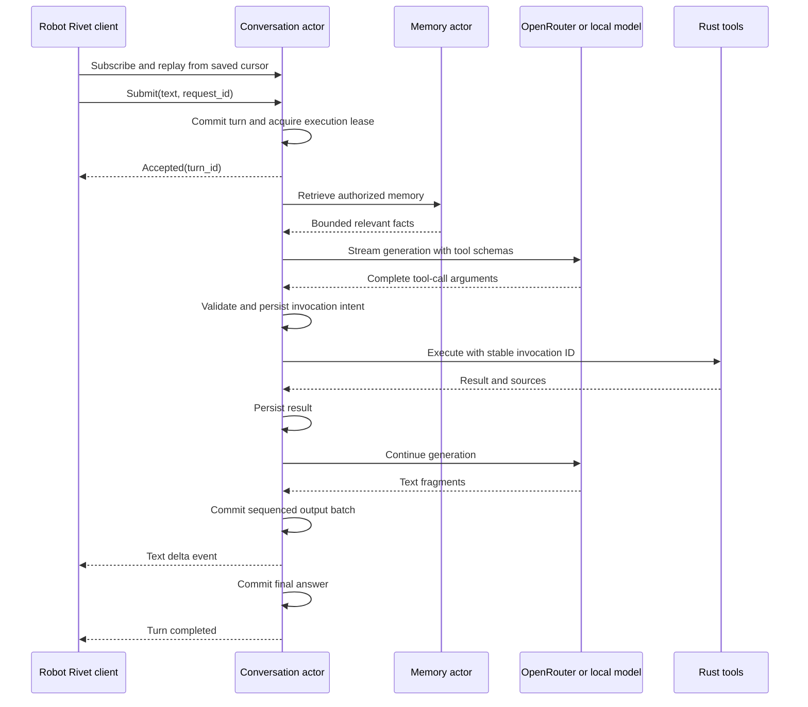

# Robot client contract

Implementation scope: the current wire contract is `crates/buddy/src/protocol.rs`; [implemented backend](backend.md) describes current behavior. The broader interfaces below remain design targets.

Status: proposed application protocol v1. The robot uses the official Rivet client against the Rivet endpoint; do not introduce a parallel custom WebSocket protocol. Start with the Rust client if supported by the robot target. If its existing application uses another supported client language, preserve the same serialized action/event contract.

## Connection and identity

[Automatic boot](boot-and-registration.md) establishes device identity and creates or recovers a durable Bot actor once Wi-Fi is available. Optional later claiming establishes account membership. The backend issues short-lived, scoped credentials; the robot never receives an engine management token, model API key or arbitrary actor access. Use a unique device key/certificate installed during assembly, an authenticated Rust bootstrap exchange, and scoped Rivet tokens. Verify issuer/key storage and SDK connection-auth binding during the initial spike.

Connection authentication is necessary but not sufficient: sensitive actions also check current device revocation, device/bot ownership and optional account membership. Bind identity to verified credentials, never user-supplied actor keys or text. Restrict actor creation and subscription independently. Model credentials stay on the server.

A small `robot-client` Rust library wraps the official Rivet client with the application contract, token refresh, cursor persistence and deduplication. It does not implement Rivet transport. Shared contracts must compile on the target without linking backend provider adapters or secrets. Validate the SDK's actor-type coupling before choosing feature-gated shared definitions versus a client-side schema mapping.

## Actions

| Proposed action | Input | Result |
|---|---|---|
| `bot.bootstrapSnapshot` | Applied config version and capabilities | Canonical bot profile, actor references and current conversation |
| `bot.configApplied` | Config revision and session epoch | Acknowledged revision |
| `device.describe` | Device capability manifest and protocol version | Accepted capabilities and server protocol |
| `conversation.open` | Optional conversation reference | Authorized conversation reference |
| `conversation.submit` | Request ID, text, optional approved attachment refs | Durable turn ID and accepted/busy status |
| `conversation.cancel` | Turn ID and request ID | Recorded cancellation status |
| `conversation.snapshot` | Conversation reference | Recent messages, active turn, current cursor |
| `conversation.replay` | Last sequence, page limit | Persisted events and next cursor |
| `conversation.approve` | Tool invocation ID, exact argument digest, decision | Accepted or stale/rejected |
| `memory.list/delete` | Authorized scope and memory ID | Current records/deletion receipt |
| `schedule.list/cancel` | Authorized scope and schedule ID | Current schedule/result |

Names illustrate the contract; final Rust action types and actor registration names are fixed during the initial spike. The device actor can facilitate conversation lookup, but subsequent conversation calls target that conversation actor directly through the Rivet client.

## Events

Envelope: `protocol_version`, `conversation_id`, `sequence`, `turn_id`, `attempt_id`, `event_type`, `timestamp`, `payload`.

Event types: `turn.accepted`, `turn.started`, `text.delta`, `tool.started`, `tool.completed`, `approval.required`, `attempt.interrupted`, `attempt.reset`, `turn.completed`, `turn.cancelled`, `turn.failed`, `reminder.ready`.

`text.delta` is a batched durable output fragment. `turn.completed` references the committed complete answer, citations and usage summary. Internal reasoning is not part of the robot protocol. Tool events expose safe status summaries rather than secrets or raw private payloads.

## Disconnection and interruption

- Retry submission with the same request ID after a timeout; it returns the original turn rather than creating a second one.
- Use exponential reconnect backoff with jitter. Save the last applied cursor on the robot.
- Subscription/replay ordering closes the replay/live gap; deduplicate by conversation sequence.
- Network loss alone does not cancel a server turn. Explicit user interruption records cancellation and prevents later attempts/tools from publishing as the active turn.
- A lost provider stream is not seamlessly resumable. A restarted attempt emits an explicit reset and preserves the interrupted attempt in history.
- The robot chooses a speech interruption policy and tracks played fragments. A reset must not blend two attempts into one spoken sentence.
- Device capability requests, if added, include command ID, expiry and expected device state. Offline commands expire; reconnection never executes stale motion.

## Compatibility and validation

Golden JSON fixtures cover every action and event. Clients ignore additive unknown fields, reject unsupported major protocol versions, and recognize unknown event types without crashing. Test disconnect before acknowledgment, during streaming, after commit but before emit, and during replay. Test credential expiry/revocation while connected, duplicate requests, stale approvals, and wrong-owner actor keys.

The integration demo must use the official Rivet client on the actual robot or a target-equivalent simulator. A curl-only test does not establish robot compatibility.
