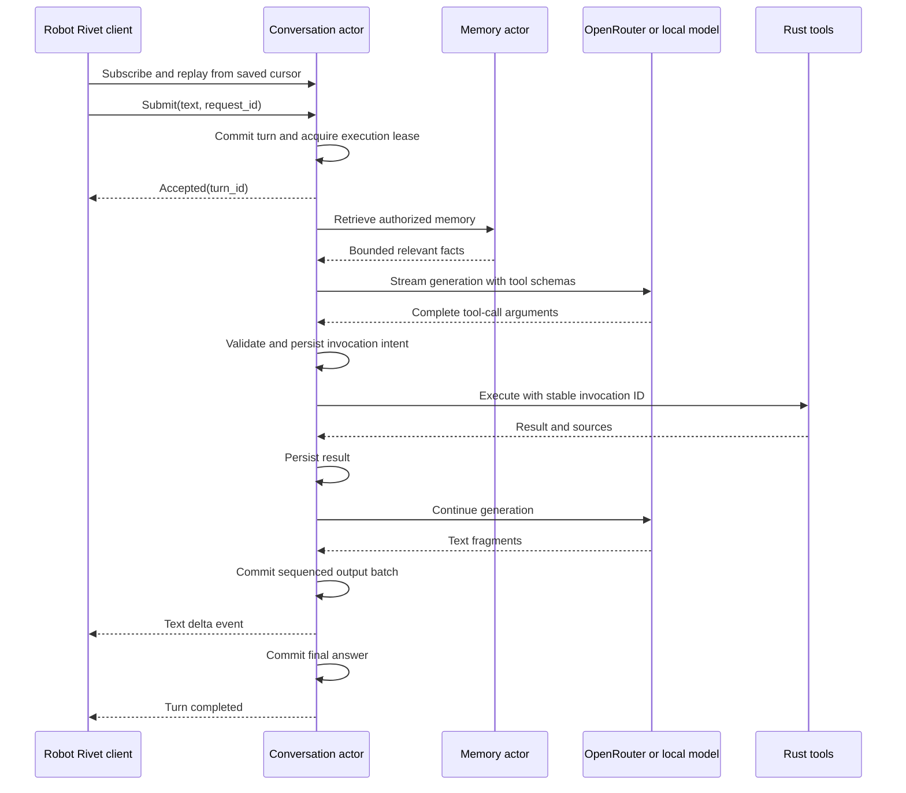

# Robot client contract

The wire contract is `crates/buddy/src/protocol.rs`; [implemented backend](backend.md) describes server behavior. The first part of this page describes the Linux device client in `apps/robot` as built. The second part, "Design targets", is the broader proposed protocol and is not all implemented.

## Implemented: Linux device client (`apps/robot`)

Target hardware is the "Pip" robot: Raspberry Pi 5 (8 GB, Raspberry Pi OS Bookworm, aarch64), ESP32-S3 face board on USB serial, microphone ring array with a local wake word and speech-to-text, and a MAX98357A I2S amplifier played through ALSA. None of this was tested on that hardware. Validation so far is unit tests and local fakes (see "Validation").

| Module | Role |
|---|---|
| `main.rs` | Settings, identity, a two-worker runtime, the final cache flush |
| `device.rs` | The main loop: control input first, every network and disk call on a lane it never waits on; reconnect, credential rotation, Wi-Fi recovery |
| `session.rs` | Bootstrap, the Rivet connection (untyped `rivetkit-client`), conversation calls over it, owner registration |
| `controller.rs` | Event order, barge-in, early speech, face state, the utterance's lifetime (transport-free, unit tested) |
| `cache.rs` | Durable cache and its single ordered writer |
| `input.rs` | Control input on stdin and the control socket |
| `face.rs` | ESP32 face bridge |
| `audio.rs` | `/v1/speech` playback through `aplay` |
| `screen.rs` | Loopback HTML panel, 127.0.0.1:8090 unless `BUDDY_SCREEN_ADDR` says otherwise (QR codes, owner confirmation) |
| `wifi.rs` | SoftAP setup through NetworkManager |
| `systemd.rs` | `sd_notify` readiness and the watchdog, gated on the device loop's heartbeat |

The robot links `robot-buddy` with `default-features = false`: the wire types only, without the actor server, Rig or `rivetkit-core`. It calls the `call` action and reads the `output` event through the untyped `rivetkit-client`. The JSON is the same as the typed client sends: one argument holding the serialized `Call`, and one argument holding the `OutputEvent`. Unit tests in `session.rs` pin both shapes.

### Control input (stdin and control socket)

Commands arrive on stdin and, when `BUDDY_CONTROL_SOCKET` names a path, on a Unix socket there (mode `0660`, group `pip-control` via `BUDDY_CONTROL_GROUP`, inside a `0711` runtime directory). The socket takes up to four writers at once and accepts a new one whenever the speech process restarts. If the path is an existing FIFO, it is read instead and reopened after each writer closes it. The systemd unit sets `/run/robot-buddy/control.sock` and gives the service no stdin. Both carry the same lines.

One line per command, at most 8 KiB. Longer lines are discarded through their newline. Invalid lines are rejected locally with a warning that never includes the line text. A closed stdin disables input; the robot keeps running. Stdin and the socket are read on their own OS threads, so an open pipe never holds up shutdown.

| Line | Meaning |
|---|---|
| any line not starting with `{` | A finalized utterance (backward compatible) |
| `{"say":"<utterance>"}` | A finalized utterance |
| `{"wake":true}` | Wake word: stop playback now, cancel the live turn, face shows listening |
| `{"listening":true}` / `{"listening":false}` | Show or clear listening without an utterance |
| `{"mute":true}` / `{"mute":false}` | Mute stops playback, shows the muted LED and suppresses automatic speech |
| `{"confirm":"123456"}` | Spoken six-digit owner-claim confirmation for headless onboarding |

A line starting with `{` is always a command, never an utterance. A JSON object must have exactly one of these keys. Utterances are trimmed and must be non-empty without control characters other than tab. Mute lives in memory; the speech front end should send its mute state again after the service restarts.

Wake, mute and every utterance act locally first: the face changes and the player is killed before any disk write or network call. `device.rs` runs one task that serves input before anything else; conversation calls, registration, cache writes, connecting and credential rotation are futures it polls but never waits on, so a hung call or a slow fsync cannot delay a stop. Measured with a fake remote whose calls hang and a fake disk that takes 100 ms per write, wake to player stopped is 13–128 µs and wake to the listening LED line 49–328 µs (15 barge-ins, debug build, macOS); in the end-to-end strict reconnect test (`tests/robot-reconnect.mjs --strict`), wake to player stop measured 17 ms.

Every utterance replaces the turn in progress. The cancel of the old turn goes out at once on its own lane; cancelling twice is harmless. Up to 8 pending cancel intents (`CancelRequest`) are persisted in the cache and sent after reconnect before any new submit. The new utterance is written to the cache with fsync, and only then submitted. A failed write keeps the utterance in memory, retries the write after 1 s, and holds back only that submit. Submits and cancels go over the open Rivet connection.

A submit with no answer (timeout, dropped socket) is uncertain: the robot replaces the connection and resubmits the same request ID, which the server deduplicates. Only a newly acknowledged turn speaks; a duplicate acknowledgement does not. If the server refuses the submit as busy (`user/busy`, with the open turn's ID as metadata), that refusal proves no open turn carries this request ID (the server deduplicates before it checks for an open turn). The server keeps at most one open turn, so the robot cancels the one it names, whatever its text, and submits once more. A second busy refusal, or any other refusal, drops the utterance and shows Sorry. A server from before the typed refusal answers busy with an internal error, which reads as a plain refusal. An acknowledgement for an utterance that was since replaced is cancelled without speaking.

Offline, mute and wake still apply at once. An utterance with no connection shows Sorry for 1.5 s and is not queued. An utterance waiting to be sent (not owned yet, or still reconnecting) carries its wall-clock creation time and expires after 60 s with Sorry; one loaded from the cache that is older, has no time, or is dated in the future is dropped at start. Wake clears a waiting utterance.

### Events and the cursor

The subscription pushes each event into a bounded channel. The next sequence (`cursor + 1`) applies directly. Already-applied sequences are ignored. A gap, a full channel, or a quiet spell triggers `Replay`, one page per loop pass so input is serviced between pages. The quiet spell is 2 s while a turn is live or audio plays; idle it is 10 s, or 60 s once this connection has delivered pushes.

The socket has no ping of its own, so a silent, half-open connection shows only as calls that never answer. While the robot waits on its own turn with nothing audible (the face reads Thinking), a replay gets 3 s, not the 15 s call deadline; unanswered, the connection is replaced. A live turn whose pushes go silent therefore recovers about 5 s after its last event. While audio plays, a slow replay waits the full deadline: the answer is already reaching the listener, and a reconnect would cut it off. Once the audio ends the 3 s deadline applies again.

The cursor is at least once. A single writer task coalesces ordinary checkpoints to one write per 30 s and writes at once on a terminal turn event, on an utterance or cancel record, and on SIGTERM or SIGINT. 30 s keeps a whole streamed answer to one SD-card write; a crash re-applies at most 30 s of events, silently, because replayed turns never speak. Each write is temp file, fsync, rename, fsync of the directory; the directory is created once at start. A cache file that cannot be read or parsed is logged (without its content) and replaced by an empty cache.

stdout is the journal, written through a bounded 256-line queue; if the consumer falls behind, dropped lines are reported as `journal dropped=<n>` so stdout never stalls the device loop. In hardware mode the line is `event sequence=<n> turn=<id> kind=<kind>` with no user or assistant text, and `text.delta` events print nothing. Full event JSON is printed only with `--simulate` (the default there, or `BUDDY_EVENTS=full`); `BUDDY_EVENTS=full` without `--simulate` is a startup error. Utterances never reach the log in either mode.

### Speech

The robot requests `/v1/speech` as soon as a submit is acknowledged as a new turn. The server holds the request until chunk 0 exists and replaces an older request for the same bot. Deduplicated submissions and replayed history never auto-play. If the early request ends with no audio, `speech.ready` index 0 starts one retry. Once `speech.ready` arrives, a 5 s first-audio deadline guards against a stalled speech response (cleared on the first PCM byte written to the player); if it expires, the robot stops the stalled request without rewarming and retries once.

One pooled HTTP client (keepalive, HTTP/2 when the server offers it) serves all speech requests, warmed with `GET /health` at session start. `/health` is liveness only and never touches the engine; `/ready` is the engine check. Stopping speech drops an HTTP/1.1 stream, so a stop into idle (wake, mute, a failed or interrupted turn) warms a new connection right after. A stop for a replacing utterance does not: that utterance's own speech request follows at once, and a warm-up would only race it. Bootstrap uses a separate client.

`aplay` gets `--buffer-time=$BUDDY_ALSA_BUFFER_US` (default 120000 µs) and `-D $BUDDY_ALSA_DEVICE` when set (for example `plughw:CARD=sndrpihifiberry,DEV=0`). A smaller buffer stops sooner on barge-in; a larger one survives CPU stalls without underruns. Measure on the device before changing it. Each write to the player and its stdin shutdown has a 2 s progress deadline; a stuck player is killed and reaped. Stop kills the player instead of letting it drain. A player that exits early ends playback. Time to first PCM byte is logged at debug level (`RUST_LOG=robot_buddy_robot=debug`). A failing playback never ends the session.

On SIGTERM or SIGINT the robot stops the speaker, closes the connection (200 ms limit), writes the in-memory cache durably, then shuts the runtime down with a 100 ms limit on blocking work. Runtime shutdown drops the playback task, and `kill_on_drop` SIGKILLs `aplay`. It exits 0 in tens of milliseconds with stdin still open; `bun run test:shutdown` checks this in CI.

### ESP32 face

Set `BUDDY_FACE_SERIAL=/dev/ttyACM0` to enable it. The robot opens the device for writing (it never creates the path) and writes one compact JSON object per line: `{"led":"<led>"}`, `{"e":"<expression>","i":<0..1>}` and `{"look":[x,y]}`. The program sets the line itself on every open, since a re-enumerated CDC-ACM port comes back at the kernel defaults (9600, cooked, echo): raw (`cfmakeraw`), 115200 baud, `CLOCAL` and `CREAD`, without `HUPCL`. It opens the device `O_WRONLY | O_NOCTTY | O_NONBLOCK`. Use the stable `/dev/serial/by-id/` path.

| State | When | LED | Expression |
|---|---|---|---|
| Offline | Not connected | `idle` | `sleepy` 0.5 |
| Idle | Connected, nothing to do | `idle` | `neutral` 0.5 |
| Listening | After `wake` until an utterance or `listening:false` | `listening` | `listening` 0.8, look `[0,0]` |
| Thinking | After submit until the first PCM byte | `thinking` | `thinking` 0.6 |
| Speaking | First PCM byte written until the player exits | `speaking` | `happy` 0.7, look `[0,0]` |
| Muted | Muted | `muted` | `neutral` 0.3 |
| Confirming | Claim confirmation window open (does not hide listening/speaking/muted) | `listening` | `happy` 0.8, look `[0,0]` |
| Sorry | 1.5 s after a failed or interrupted turn | `idle` | `sad` 0.6 |

Expressions used: neutral, happy, thinking, listening, sad, sleepy. Changes go out at once; the current state is re-sent every 1.5 s, inside the ESP32's 5 s fallback. Writes run on their own task with a 500 ms deadline. Only the latest state is kept. If the device disappears (USB re-enumeration), the writer reopens it every second.

### Reconnect, credential rotation and Wi-Fi

A close or error on the Rivet connection, an uncertain call (no answer within 15 s, or 3 s for a replay while the robot waits on its turn), a failed registration or expired credentials replace the connection: the old one is disconnected (2 s limit, in the background), the face shows Offline, and the robot reconnects. Reconnects use exponential backoff from 1 s to 30 s with jitter (a random delay in the upper half of each step). Only a session that lasted 30 s resets it.

Credentials are rotated without going offline. Session lifetime comes from the bundle's `expires` against the server's `Date` header, clamped to 2–60 minutes and measured on the monotonic clock from before the request. Five minutes before expiry (never sooner than a minute after connecting) the next session connects in the background and is probed by running one `Replay` within 5 s; a failed candidate is dropped and the current session and player stay untouched. Once probed, it takes over when no call is in flight and no turn is live, or a minute before expiry even mid-turn. Audio already playing finishes on the old speaker; the old connection is then closed. A failed refresh retries every 10 s and shows nothing. Ownership is checked every 3 s until the robot is owned, then every 5 minutes.

There is no Wi-Fi gate at start: input is served at once. After three unhealthy attempts in a row the robot checks the link on each attempt. Until it has reached the server once, setup reopens after 1 minute without a network; afterwards after `BUDDY_WIFI_GRACE_SECS` (default 300). Reaching the server counts as a working uplink, whatever the interface. The setup hotspot uses a per-robot random SSID/password persisted in `BUDDY_SETUP_WIFI_FILE` (0600) and printed by `robot-buddy-robot setup-card`. A failed home-network join keeps any existing working home profile in place. The hotspot stays up for 10 minutes, then is removed so NetworkManager can rejoin a known network, and input keeps working throughout. `nmcli` runs without a shell, one argument per value, with a 45 s deadline and `kill_on_drop`. SSIDs are 1–32 bytes without control characters; passwords are 8–63 printable ASCII characters. A failure to restore the setup hotspot is logged and shown on the panel.

### Environment

| Variable | Default | Purpose |
|---|---|---|
| `BUDDY_SERVER_URL`, `BUDDY_IDENTITY_FILE` | required | Server and device identity (0600, `O_NOFOLLOW`) |
| `BUDDY_CACHE_FILE` | `/var/lib/robot-buddy/cache.json` | Cursor, pending utterance, cancel intents, claim URL |
| `BUDDY_SPEECH` | off | `true` enables playback |
| `BUDDY_ALSA_DEVICE`, `BUDDY_ALSA_BUFFER_US` | ALSA default, 120000 | Player device and buffer |
| `BUDDY_FACE_SERIAL` | off | ESP32 serial device |
| `BUDDY_EVENTS` | `compact` (`full` with `--simulate`) | stdout detail; `full` requires `--simulate` |
| `BUDDY_WIFI_INTERFACE`, `BUDDY_WIFI_GRACE_SECS` | `wlan0`, 300 | Wi-Fi setup |
| `BUDDY_SETUP_WIFI_FILE` | `/var/lib/robot-buddy/setup-wifi.json` | Per-robot setup hotspot name and password (0600) |
| `BUDDY_CONTROL_SOCKET`, `BUDDY_CONTROL_GROUP` | off (unit sets `/run/robot-buddy/control.sock`), `pip-control` | Control input socket (mode 0660) or FIFO, and socket group |
| `BUDDY_SCREEN_ADDR` | `127.0.0.1:8090` | Panel address; loopback `ip:port` only, `off` or empty disables it, anything else fails at start |

### Building for the Pi 5

`.cargo/config.toml` adds `-C target-cpu=cortex-a76` for `aarch64-unknown-linux-gnu` only. On the Pi: `cargo build --release -p robot-buddy-robot`. From another machine: `rustup target add aarch64-unknown-linux-gnu`, then `cross build --release --target aarch64-unknown-linux-gnu -p robot-buddy-robot`, or `cargo build` with an aarch64 linker configured. Install the binary to `/usr/local/bin/robot-buddy-robot` and use [the systemd unit](../../infra/robot-buddy.service); its header lists the install steps. In short, as root once: create the system group `pip-control` and account `robot-buddy` (no login shell, groups `audio`, `dialout`, `pip-control`), install the binary, put the identity file in `/etc/robot-buddy/` (mode `0600`, `robot-buddy:robot-buddy`) and [`device.env`](../../infra/device.env.example) beside it (mode `0600`), install the [polkit rule](../../infra/robot-buddy-nm.rules) as `/etc/polkit-1/rules.d/50-robot-buddy-nm.rules`, install the unit, run `runuser -u robot-buddy -- /usr/local/bin/robot-buddy-robot setup-card`, then `systemctl daemon-reload && systemctl enable --now robot-buddy` (do not enable `NetworkManager-wait-online.service`). Put the speech process's account in `pip-control` only, never `robot-buddy`.

The service runs as `robot-buddy`, not root, with `UMask=0077`. The polkit rule lets that account, and only it, modify system NetworkManager profiles and control the network (it no longer grants `wifi.share.open` or `enable-disable-wifi`); polkit cannot tell profiles apart, so these cover every profile. The only capability is `CAP_NET_BIND_SERVICE`, for the setup page on 10.42.0.1:80. The unit is sandboxed (`ProtectSystem=strict`, `ProtectHome=yes`, `PrivateTmp=yes`, writes only to `/var/lib/robot-buddy` and `/run/robot-buddy`, `NoNewPrivileges`, `ProtectProc=invisible`, `MemoryDenyWriteExecute=yes`, `RestrictAddressFamilies`, `SystemCallFilter=@system-service`, 256 MB memory cap, 128 tasks), restarts forever, and runs at `Nice=-5` with best-effort I/O priority 2. It is `Type=notify`: READY=1 follows the panel, face and control socket. With `WatchdogSec=60s` the device loop beats on every pass and wakes at least every 15 s; the watchdog is pinged every 30 s only if the loop beat since the last ping, so a wedged loop, not only a wedged runtime, is restarted.

### Validation

Unit and async tests cover input parsing, bounded reads and EOF, cursor coalescing and crash safety, the event fast path and replay, barge-in ordering, early speech, and in `device.rs` the whole loop against a fake remote and speaker: barge-in while calls hang (the latency above), a lost submit acknowledgement (same request ID, no old speech, the next turn plays), rotation mid-speech (speech continues, old connection closed, never Offline), offline mute and say, utterance expiry, reconnect on close, a silent connection replaced within 6 s only while a turn is awaited, the loop's watchdog heartbeat while idle, and Wi-Fi setup after the boot grace. `systemd.rs` tests that the watchdog is pinged only while the loop beats; `audio.rs` that only a stop into idle sends the `/health` warm-up; `session.rs` that a busy refusal yields the open turn's ID from the client's exact error text. A sentinel prompt never appears in compact journal lines. Also covered: face states and heartbeat cadence (paused time), exact face lines through a file, the stuck-player deadline, and a latency trace against a local fake `/v1/speech` (300 ms header delay, then streamed PCM; first byte measured per turn, one TCP connection for two turns). That trace uses plain HTTP on loopback, so it shows connection reuse but not TLS savings. No Pi, ESP32, microphone or amplifier was available: serial timing, ALSA underruns at 120 ms and real barge-in latency are unmeasured.

## Design targets

The interfaces below remain proposals. The robot uses the official Rivet client against the Rivet endpoint; do not introduce a parallel custom WebSocket protocol. Start with the Rust client if supported by the robot target. If its existing application uses another supported client language, preserve the same serialized action/event contract.

### Connection and identity

[Automatic boot](boot-and-registration.md) establishes device identity and creates or recovers a durable Bot actor once Wi-Fi is available. Optional later claiming establishes account membership. The backend issues short-lived, scoped credentials; the robot never receives an engine management token, model API key or arbitrary actor access. Use a unique device key/certificate installed during assembly, an authenticated Rust bootstrap exchange, and scoped Rivet tokens. Verify issuer/key storage and SDK connection-auth binding during the initial spike.

Connection authentication is necessary but not sufficient: sensitive actions also check current device revocation, device/bot ownership and optional account membership. Bind identity to verified credentials, never user-supplied actor keys or text. Restrict actor creation and subscription independently. Model credentials stay on the server.

A small `robot-client` Rust library wraps the official Rivet client with the application contract, token refresh, cursor persistence and deduplication. It does not implement Rivet transport. Shared contracts must compile on the target without linking backend provider adapters or secrets. Validate the SDK's actor-type coupling before choosing feature-gated shared definitions versus a client-side schema mapping.

### Actions

| Proposed action | Input | Result |
|---|---|---|
| `bot.bootstrapSnapshot` | Applied config version and capabilities | Canonical bot profile, actor references and current conversation |
| `bot.configApplied` | Config revision and session epoch | Acknowledged revision |
| `device.describe` | Device capability manifest and protocol version | Accepted capabilities and server protocol |
| `conversation.open` | Optional conversation reference | Authorized conversation reference |
| `conversation.submit` | Request ID, text, optional approved attachment refs | Durable turn ID and accepted/busy status |
| `conversation.cancel` | Turn ID and request ID | Recorded cancellation status |
| `conversation.snapshot` | Conversation reference | Recent messages, active turn, current cursor |
| `conversation.replay` | Last sequence, page limit | Persisted events and next cursor |
| `conversation.approve` | Tool invocation ID, exact argument digest, decision | Accepted or stale/rejected |
| `memory.list/delete` | Authorized scope and memory ID | Current records/deletion receipt |
| `schedule.list/cancel` | Authorized scope and schedule ID | Current schedule/result |

Names illustrate the contract; final Rust action types and actor registration names are fixed during the initial spike. The device actor can facilitate conversation lookup, but subsequent conversation calls target that conversation actor directly through the Rivet client.

### Events

Envelope: `protocol_version`, `conversation_id`, `sequence`, `turn_id`, `attempt_id`, `event_type`, `timestamp`, `payload`.

Event types: `turn.accepted`, `turn.started`, `text.delta`, `tool.started`, `tool.completed`, `approval.required`, `attempt.interrupted`, `attempt.reset`, `turn.completed`, `turn.cancelled`, `turn.failed`, `reminder.ready`.

`text.delta` is a batched durable output fragment. `turn.completed` references the committed complete answer, citations and usage summary. Internal reasoning is not part of the robot protocol. Tool events expose safe status summaries rather than secrets or raw private payloads.

### Disconnection and interruption

- Retry submission with the same request ID after a timeout; it returns the original turn rather than creating a second one.
- Use exponential reconnect backoff with jitter. Save the last applied cursor on the robot.
- Subscription/replay ordering closes the replay/live gap; deduplicate by conversation sequence.
- Network loss alone does not cancel a server turn. Explicit user interruption records cancellation and prevents later attempts/tools from publishing as the active turn.
- A lost provider stream is not seamlessly resumable. A restarted attempt emits an explicit reset and preserves the interrupted attempt in history.
- The robot chooses a speech interruption policy and tracks played fragments. A reset must not blend two attempts into one spoken sentence.
- Device capability requests, if added, include command ID, expiry and expected device state. Offline commands expire; reconnection never executes stale motion.

### Compatibility and validation

Golden JSON fixtures cover every action and event. Clients ignore additive unknown fields: every message, and every settings type (voice, context, synthesis, speech rule, persona draft) a client or the server reads back from storage, tolerates fields a newer peer added. Settings writes are the one strict place: the config inside `set_voice_config` and `set_context_config`, the persona inside `save_persona`, and the matching model tool arguments reject unknown fields at any depth and name them, so a typo is an error rather than a dropped setting. The command envelope itself stays additive. Clients reject unsupported major protocol versions, and recognize unknown event types without crashing. Test disconnect before acknowledgment, during streaming, after commit but before emit, and during replay. Test credential expiry/revocation while connected, duplicate requests, stale approvals, and wrong-owner actor keys.

The integration demo must use the official Rivet client on the actual robot or a target-equivalent simulator. A curl-only test does not establish robot compatibility.
