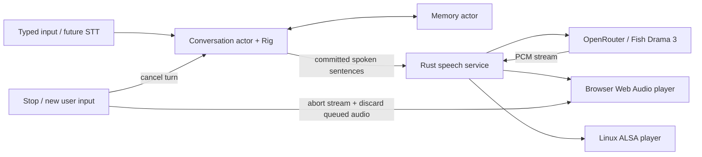

# Voice delivery

The local browser lab and Linux robot share an authenticated HTTP PCM contract. Rivet owns durable conversation text and tool state; the speech service owns only transient media work. Speech recognition and automatic microphone interruption are not implemented yet: the lab accepts typed input and returns spoken answers.

## Inference and persona

Local inference uses `z-ai/glm-5.3-flash:nitro`, with `AI_REASONING_EFFORT=low`. OpenRouter lists low, high and max for this model, with mandatory reasoning. Nitro sorts by throughput and admits eligible priority endpoints; it does not guarantee minimum first-token latency. Sources: [model](https://openrouter.ai/z-ai/glm-5.3-flash), [reasoning discovery](https://openrouter.ai/docs/guides/best-practices/reasoning-tokens), [Nitro](https://openrouter.ai/docs/guides/routing/model-variants/nitro).

The per-bot system persona is revisioned in Conversation actor SQLite, seeded from `crates/buddy/src/prompts/persona.txt`. The agent reads and rewrites it with `read_system_prompt` and `update_system_prompt`; updates take effect in the spoken phase after tool work. Compare-and-swap revisions prevent stale overwrites; the last 16 versions are retained. The lab can inspect those versions. Buddy is playful, optimistic and lightly sassy; jokes are kind, sparse, and dropped for serious subjects. Replies default to one to three natural sentences. The prompt forbids narrating reasoning, tools, internal instructions, unsupported physical actions, and voice markup.

Voice identity and delivery direction are separately configured in revisioned Conversation actor state, seeded from `crates/buddy/src/prompts/voice.txt`. It asks Drama 3 for a warm, restrained conversational performance and appropriate emotional sensitivity. OpenRouter passes `instructions` to Fish as a direction at the start of the text. The canonical answer stays plain dialogue; the model does not need to emit bracket tags or speaker labels. This avoids accidentally reading directions and preserves clean history. Sources: [Fish direction guide](https://fish.audio/drama-3/), [OpenRouter TTS](https://openrouter.ai/docs/guides/overview/multimodal/tts).

## Audio contract

`POST /v1/speech` accepts `SpeechRequest { turn_id, stream }` and `Authorization: Bearer <device-session>`. With `stream: true`, the server reads committed sentence chunks from the authorized Conversation actor while the turn is running or completed. Missing chunks wait; canceled, failed or interrupted turns stop delivery. With `stream: false` (the default), `SpokenAnswer` permits only completed-answer replay. Callers cannot supply speech text. The lab's cookie/CSRF endpoint uses the same service with its bound device identity.

A successful response is signed 16-bit little-endian PCM with explicit sample rate/channels in Content-Type and `x-audio-encoding: pcm_s16le`, plus `x-audio-turn-id`. The observed Drama 3 response is mono at 44.1 kHz; clients parse and validate metadata rather than assuming a fixed rate. Audio is streamed with backpressure, not collected as a base64 actor event or saved in SQLite.

Four speech streams may run concurrently per process, and one per bot. Provider deadlines, a 12 KB answer limit, a 16 MiB audio limit and bounded client queues constrain work. Browser disconnect cancels local forwarding and drops its capacity lease. Accepted upstream work may still incur cost. Error bodies are never played as audio. There is no automatic paid synthesis retry.

Ordinary conversation uses one inference request and streams Rig's response-text events directly into sentences. Rig reasoning events and unknown provider payloads are never forwarded. Starting a tool call closes direct speech admission; a tool call after admitted dialogue fails the turn without executing that tool. The prompt requires response text to be spoken dialogue, with analysis confined to the separate reasoning channel. This is a typed channel boundary, not a semantic classifier: an incorrectly placed narration in the model's response text cannot be identified reliably by the transport.

Requests requiring tools retain silent action rounds followed by a tool-disabled spoken generation using updated persona/settings and verified results. Planner prose and reasoning are removed from that final input. A UTF-8-safe accumulator flushes sentences and bounds unpunctuated segments. Voice is pinned at speech admission for the whole turn.

The server submits chunks sequentially to OpenRouter's HTTP speech endpoint and forwards one continuous PCM response to the client. It checks consistent format, authorization and cancellation between/through requests. There are at most 64 chunks, a 300-second media deadline, and no automatic paid retry. A crash in spoken generation interrupts the turn rather than regenerating already spoken text. Committed text precedes speech admission. There is no mandatory extra model call for ordinary replies. Separate speech requests can produce prosody gaps even with pinned voice settings.

## Browser and robot behavior

The lab has an opt-in voice toggle, speaking face, replay/stop controls, format display, first-audio timing and buffer size. The Web Audio player schedules bounded PCM frames. Stop aborts the network request, invalidates the playback generation and stops queued sources. New user input also stops prior speech. History reload does not automatically replay audio.

The Linux robot uses the official Rivet Rust client for actor actions/events and the same `/v1/speech` service for media. Enable `BUDDY_SPEECH=true` and install ALSA `aplay`. Its shell-free player consumes PCM through a pipe with bounded buffering; cancellation kills the child and drops the stream. Only newly acknowledged turns from the current connection are auto-spoken, not old deduplicated submissions or replayed history. Hardware playback has not been verified on the real robot.

The browser currently mediates actor control through its authenticated lab backend; it does not emulate NetworkManager or hardware acoustics. Both paths share the same actor commands, committed spoken-text gate and audio contract. This is useful behavioral simulation, not evidence of physical device timing.

## Future voice input and alternatives

Add streaming speech recognition, local VAD/echo handling and push-to-talk after measuring this output path. Only finalized utterances should become idempotent user turns. Partial recognition and raw audio should remain ephemeral. Barge-in must cancel the active turn and discard previous playback generations at the device. Never automatically replay old speech after reconnect.

`google/gemini-3.8-flash-tts` remains a candidate for a future adapter. The current adapter intentionally supports the selected Drama 3 model only. Compare first audio, pronunciation, consistent voice across requests and interruption on actual hardware before changing providers. The curated catalog is Adrian (default), Delia and Sheila, using public IDs from the [Fish Drama 3 examples](https://docs.fish.audio/features/text-to-speech/drama-3). `get_voice_config` and `update_voice_config` let the agent change the selected speaker or delivery on request. The typed enum rejects arbitrary IDs. Every speech request explicitly supplies the saved ID; style-only changes preserve it. Responses identify voice ID and settings revision. Provider generation can still vary in prosody; the same voice ID does not guarantee identical audio. No voice cloning or separate Fish credential is required.

## Robot runtime context

Conversation owns revisioned `ContextConfig`: IANA timezone and optional plain location label. It defaults to UTC and unknown location; the server never guesses from IP or treats its own timezone as the robot's. `get_context_config` / `update_context_config` support user requests such as “I'm in New York; use America/New_York.” The runtime injects server UTC, local datetime/date/weekday, timezone, settings revision and location source before every model request, including after tools and resumed runs. Chrono-TZ handles daylight-saving offsets. Editable persona checkpoints never freeze the clock. Host clock synchronization is an operational prerequisite. GPS-based relocation and automatic browser/device timezone adoption are not implemented.

Settings writes use revision checks and commit tool receipts in the same SQLite transaction. Tool updates require a running turn. They cannot alter API credentials, network endpoints or code-enforced speech/auth/budget boundaries.

## Persona adaptation

The runtime character-design instructions in `prompts/persona-design.txt` tell Rig to replace contradictory traits with a coherent profile, including brief style examples, for explicit lasting changes. Temporary scenes stay conversational. Routine turns do not rewrite the saved prompt. The agent applies new style immediately and persists it for following turns; voice delivery changes are separate revisioned writes and preserve speaker identity. These instructions guide model behavior rather than guarantee perfect characterization. Test desired characters with real conversations, including serious topics and tool failures.

## Saved personas and synthesis controls

`list_personas`, `get_persona`, `save_persona`, and `activate_persona` manage up to 50 named profiles, retaining the latest 16 immutable versions per name. Each version stores a complete prompt plus voice configuration. Activation selects an exact version and atomically updates both live settings with compare-and-swap revisions and the tool receipt. A stale voice revision rolls back the prompt change. The default Buddy profile is seeded separately so users can return to it. Ordinary standalone prompt/voice edits retain their own history; save them as a named profile to make them selectable together. Location/timezone are independent.

Voice configuration includes speaker, delivery, temperature/top-p, prosody speed/volume/loudness normalization, text normalization/language, latency, chunk sizes/continuity, token cap, repetition penalty and early-stop threshold. Typed bounds reject invalid values; the HTTP audio format and security/resource limits remain application-owned. Speed is also mapped to OpenRouter’s top-level `speed` field; a live 0.5 vs 1.5 comparison confirmed substantially different output durations, while the nested speed option alone did not. Other Fish options are sent under OpenRouter `provider.options.fish-audio`; a successful provider request establishes acceptance, not independent proof that each control changes sound. Sources: [Fish TTS parameters](https://docs.fish.audio/api-reference/endpoint/openapi-v1/text-to-speech), [OpenRouter passthrough](https://openrouter.ai/docs/guides/overview/multimodal/tts).

Role direction and few-shot examples follow the general pattern described in [Anthropic prompting guidance](https://platform.claude.com/docs/en/build-with-claude/prompt-engineering/claude-prompting-best-practices); behavior still needs evaluation on the configured GLM model. Celebrity-inspired performance uses the curated speakers and qualitative direction, not a claim of exact voice cloning.

“Act like X” defaults to a lasting named persona-and-voice switch. Explicitly temporary requests remain conversational. The activation tool accepts only profile name/version; the application reads concurrency revisions, so the model cannot invent them. Direct client activation still requires expected prompt/voice revisions.

## Fine-grained Drama 3 performance

The model receives a dedicated Drama 3 guide. Saved voice `speech_rules` apply up to 32 exact, case-sensitive word/phrase rules when preparing spoken text for TTS. Styles use the documented paired tags (whisper, emphasis, soft, fast, slow, stress, forceful). English phoneme rules replace one word with validated CMU Arpabet; punctuation stays outside the generated tags. Longest overlapping matches win. The rendered provider input is capped at 24 KiB; canonical transcript text is unchanged. Rules are stored with persona versions and are visible in the voice settings inspector.

Global emotion, intent, accent and pacing are described in the delivery prompt. The emotion guide primarily documents S2; the older fine-grained guide also contains V1.6 parenthesized effects. Buddy's runtime guide uses Drama 3 syntax instead of mixing those legacy effects into dialogue. Per-utterance arbitrary stage-direction insertion and multi-speaker dialogue are not implemented. Sources: [Drama 3](https://docs.fish.audio/features/text-to-speech/drama-3), [emotion guide](https://docs.fish.audio/developer-guide/core-features/emotions), [fine-grained guide](https://docs.fish.audio/developer-guide/core-features/fine-grained-control), [English pronunciation](https://docs.fish.audio/developer-guide/core-features/fine-grained-control/english).

## OpenRouter transport

Inference and synthesis both use OpenRouter. Each speech HTTP request takes a complete sentence or bounded clause and streams audio output; it does not accept incremental input text. The server chains these requests while final-response inference continues. No direct Fish transport or separate Fish credential is needed. Source: [OpenRouter speech API](https://openrouter.ai/docs/guides/overview/multimodal/tts).
