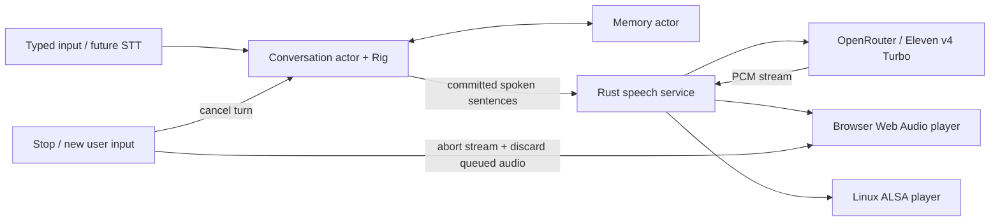

# Voice delivery

The local browser lab and Linux robot share an authenticated HTTP PCM contract. Rivet owns durable conversation text and tool state; the speech service owns only transient media work. Speech recognition and automatic microphone interruption are not implemented yet: the lab accepts typed input and returns spoken answers.

## Inference and persona

Local inference uses `z-ai/glm-5.3-flash:nitro`, with `AI_REASONING_EFFORT=low`. OpenRouter lists low, high and max for this model, with mandatory reasoning. Nitro sorts by throughput and admits eligible priority endpoints; it does not guarantee minimum first-token latency. Sources: [model](https://openrouter.ai/z-ai/glm-5.3-flash), [reasoning discovery](https://openrouter.ai/docs/guides/best-practices/reasoning-tokens), [Nitro](https://openrouter.ai/docs/guides/routing/model-variants/nitro).

The per-bot system persona is revisioned in Conversation actor SQLite, seeded from `crates/buddy/src/prompts/persona.txt`. The agent reads and rewrites it with `read_system_prompt` and `update_system_prompt`; updates take effect in the spoken phase after tool work. Compare-and-swap revisions prevent stale overwrites; the last 16 versions are retained. The lab can inspect those versions. Default Buddy is J.P.-inspired: easy, warm, a little hazy, and plain-spoken, and still a robot. The first sentence answers. Replies are one or two short sentences, with a third only when the task needs it. The haze drops for health, safety, and precise facts. The prompt forbids narrating reasoning, tools, internal instructions, unsupported physical actions, and voice markup. It does not claim to be the actor.

Voice identity and the delivery note are separately configured in revisioned Conversation actor state, seeded from `crates/buddy/src/prompts/voice.txt`. The note describes Will, a young American premade voice, in the spirit of J.P. from Grandma's Boy. Eleven v4 Turbo does not read `instructions` or that note. The speech request sends the answer text, the catalog name, PCM, `provider.zdr`, a fixed seed, and voice settings with no speed field. The canonical answer stays plain dialogue. Sources: [Eleven v4 Turbo](https://openrouter.ai/elevenlabs/eleven-v4-turbo), [OpenRouter TTS](https://openrouter.ai/docs/guides/overview/multimodal/tts).

## Audio contract

`POST /v1/speech` accepts `SpeechRequest { turn_id, stream }` and `Authorization: Bearer <device-session>`. The bearer is checked from headers before any body byte is read; the body (at most 1 KiB) must then arrive within 5 s (408 on timeout). Only a request that has taken a speech stream slot gets the long head deadline (see [Security](../security.md)). Once admitted, the stream runs on its own short-lived actor session (valid for its deadline plus 1 minute), so an expiring bearer does not cut off a stream mid-reply; revocation still stops it. Failure statuses distinguish 401 (bad/missing credentials), 403 (forbidden/revoked), 404 (not found), 408 (body deadline), 409 (conflict), 502/503/504 (upstream/unavailable/timeout). With `stream: true`, the server reads committed sentence chunks from the authorized Conversation actor while the turn is queued, running or completed. A request may arrive before the turn starts or before chunk 0 exists; it waits. The server listens for this turn's `speech.ready` and `turn.*` events on its own Rivet connection and also polls every 250 ms, so a missed event or failed subscription only costs latency. Canceled, failed or interrupted turns stop delivery. Markup-only chunks are skipped without a provider call. With `stream: false` (the default), `SpokenAnswer` permits only completed-answer replay. Callers cannot supply speech text. The lab's cookie/CSRF endpoint uses the same service with its bound device identity.

A successful response is signed 16-bit little-endian PCM. Downstream Content-Type always carries explicit sample rate and channels, plus `x-audio-encoding: pcm_s16le` and `x-audio-turn-id`. OpenRouter's bare `audio/pcm` means mono 24 kHz; a header that already names rate and channels is parsed as written. Clients must not assume one rate once the header is explicit. Audio is streamed with backpressure, not collected as a base64 actor event or saved in SQLite.

Four speech streams may run per process, one per bot. The newest request for a bot wins: it stops the older stream and takes its slot. This matters after barge-in, when the server may not have seen the old connection close yet. Provider deadlines, a 12 KB answer limit, a 16 MiB audio limit and a bounded output queue constrain work. Each stream runs in its own task with a 300-second deadline. When the server sees the client disconnect, the task stops, drops its in-flight and prefetched requests and frees the lease. A client that stops reading still loses the lease at the deadline. Accepted upstream work may still incur cost. Provider error bodies are read up to 1 KiB and dropped; only the status code is logged. Error bodies are never played as audio. There is no automatic paid synthesis retry.

Ordinary conversation uses one inference request and streams Rig's response-text events directly into sentences. Rig reasoning events and unknown provider payloads are never forwarded. Starting a tool call closes direct speech admission. A tool call after admitted dialogue (small models often say "Got it" first) keeps what was already spoken, runs the tool, and the tool-disabled spoken phase continues from the spoken prefix without repeating it; chunk numbers continue where the direct call stopped. A tool that returns an error (bad arguments, stale revision, full memory) hands the error to the model as its result instead of failing the turn, so the model can retry or explain. The prompt requires response text to be spoken dialogue, with analysis confined to the separate reasoning channel. This is a typed channel boundary, not a semantic classifier: an incorrectly placed narration in the model's response text cannot be identified reliably by the transport.

Requests requiring tools retain silent action rounds followed by a tool-disabled spoken generation using updated persona/settings and verified results. Planner prose and reasoning are removed from that final input. A UTF-8-safe accumulator flushes sentences and bounds unpunctuated segments. Voice is pinned at speech admission for the whole turn.

The server synthesizes one sentence ahead. While sentence N streams, it waits for sentence N+1, starts its request and buffers up to 2 MiB of its PCM. Output stays in sentence order, so the client hears no gap between sentences when synthesis keeps up. A stream has at most two upstream requests; the process has at most eight. The cost: barge-in can waste one extra synthesized sentence, the prefetched one. Every sentence must have the first sentence's format and whole PCM frames. The pinned voice is decoded and validated once per stream, not per sentence. When a stream ends in failure (a newer request replaced it, revocation, a provider error), the failure reaches the client before any PCM still queued; that PCM is dropped. A stream that finished cleanly drains its queue.

Authorization runs beside the audio, not in its path. Every actor call the stream makes is authorized by the actor, so each successful chunk read counts as a check. The 500 ms cadence starts after the first authorized read and only sends a separate check when no read has succeeded for 500 ms. That check asks for a chunk index past the 64-chunk cap, which the actor answers from the turn's status alone. Audio flows until 2 s after the last successful authorized call was sent. A failed check stops the stream. A check that hangs pauses audio and stops the stream after 5 s. Completed-answer replay gets the same checks. There are at most 64 chunks, a 300-second media deadline, and no automatic paid retry. A crash in spoken generation interrupts the turn rather than regenerating already spoken text. Committed text precedes speech admission. There is no mandatory extra model call for ordinary replies. Separate speech requests can produce prosody gaps even with pinned voice settings.

## Browser and robot behavior

The lab has an opt-in voice toggle, speaking face, replay/stop controls, format display, first-audio timing and buffer size. The Web Audio player schedules bounded PCM frames. Stop aborts the network request, invalidates the playback generation and stops queued sources. New user input also stops prior speech. History reload does not automatically replay audio.

The Linux robot uses the official Rivet Rust client for actor actions/events and the same `/v1/speech` service for media. Enable `BUDDY_SPEECH=true` and install ALSA `aplay`. Its shell-free player consumes PCM through a pipe with bounded buffering; cancellation kills the child and drops the stream. Only newly acknowledged turns from the current connection are auto-spoken, not old deduplicated submissions or replayed history. Hardware playback has not been verified on the real robot.

The browser currently mediates actor control through its authenticated lab backend; it does not emulate NetworkManager or hardware acoustics. Both paths share the same actor commands, committed spoken-text gate and audio contract. This is useful behavioral simulation, not evidence of physical device timing.

## Future voice input and alternatives

Add streaming speech recognition, local VAD/echo handling and push-to-talk after measuring this output path. Only finalized utterances should become idempotent user turns. Partial recognition and raw audio should remain ephemeral. Barge-in must cancel the active turn and discard previous playback generations at the device. Never automatically replay old speech after reconnect.

The PCM adapter accepts `elevenlabs/eleven-v4-turbo` only. That model is on the OpenRouter zero-data-retention endpoint list. Account ZDR blocks SpaceXAI-hosted Grok Voice, so that route is not used. `google/gemini-3.8-flash-tts` stays a future candidate because its listed endpoints retain data for safety. The curated catalog is the 21 premade names. Will is the default. Stored Fish names load as Will (`adrian`), Sarah (`delia`), and Jessica (`sheila`); new saves use the premade name. The typed enum rejects any other ID. Every speech request sends that name. Style-only changes preserve it. Responses identify the voice name and settings revision. The same name does not guarantee identical audio, and it is not a clone of any actor. No separate ElevenLabs credential is required for these premade names.

## Robot runtime context

Conversation owns revisioned `ContextConfig`: IANA timezone and optional plain location label. It defaults to UTC and unknown location; the server never guesses from IP or treats its own timezone as the robot's. `get_context_config` / `update_context_config` support user requests such as “I'm in New York; use America/New_York.” The runtime injects server UTC, local datetime/date/weekday, timezone, settings revision and location source before every model request, including after tools and resumed runs. Chrono-TZ handles daylight-saving offsets. Editable persona checkpoints never freeze the clock. Host clock synchronization is an operational prerequisite. GPS-based relocation and automatic browser/device timezone adoption are not implemented.

Settings writes use revision checks and commit tool receipts in the same SQLite transaction. Tool updates require a running turn. They cannot alter API credentials, network endpoints or code-enforced speech/auth/budget boundaries.

## Persona adaptation

The runtime character-design instructions in `prompts/persona-design.txt` tell Rig to replace contradictory traits with a coherent profile, including brief style examples, for explicit lasting changes. Temporary scenes stay conversational. Routine turns do not rewrite the saved prompt. The agent applies new style immediately and persists it for following turns; voice delivery changes are separate revisioned writes and preserve speaker identity. These instructions guide model behavior rather than guarantee perfect characterization. Test desired characters with real conversations, including serious topics and tool failures.

## Saved personas and synthesis controls

`list_personas`, `get_persona`, `save_persona`, and `activate_persona` manage up to 50 named profiles, retaining the latest 16 immutable versions per name. Each version stores a complete prompt plus voice configuration. Activation selects an exact version and atomically updates both live settings with compare-and-swap revisions and the tool receipt. Saved versions stay put. The one exception is an untouched factory Buddy version 1, which the first start after this change rewrites in place. A stale voice revision rolls back the prompt change. The default Buddy profile is seeded separately so users can return to it. Ordinary standalone prompt/voice edits retain their own history; save them as a named profile to make them selectable together. Location/timezone are independent.

Saved voice configuration still includes speaker, delivery, and the older synthesis fields. Typed bounds reject invalid values. Eleven v4 Turbo receives the speaker name, the spoken line, seed `7`, and voice settings (`stability` 0.5, `similarity_boost` 0.75, `style` 0, `use_speaker_boost` true). It does not receive `instructions`, a top-level `speed`, or `provider.options.fish-audio`. A non-default top-level speed is rejected by this model. The stored synthesis numbers remain so older profiles still load. They do not change the audio. Sources: [ElevenLabs on OpenRouter](https://openrouter.ai/blog/announcements/elevenlabs-on-openrouter/), [OpenRouter TTS](https://openrouter.ai/docs/guides/overview/multimodal/tts).

Role direction and few-shot examples follow the general pattern described in [Anthropic prompting guidance](https://platform.claude.com/docs/en/build-with-claude/prompt-engineering/claude-prompting-best-practices); behavior still needs evaluation on the configured GLM model. Celebrity-inspired performance uses the curated speakers and qualitative direction, not a claim of exact voice cloning.

“Act like X” defaults to a lasting named persona-and-voice switch. Explicitly temporary requests remain conversational. The activation tool accepts only profile name/version; the application reads concurrency revisions, so the model cannot invent them. Direct client activation still requires expected prompt/voice revisions.

## Speech rules

The model receives `prompts/drama3-guide.txt`, which now describes Eleven v4 Turbo. The filename stays because the harness includes it. Saved `speech_rules` still match up to 32 exact, case-sensitive words or phrases. Whisper and soft prefix `[whispering]`. Emphasis, stress, forceful, fast, slow, and phoneme rules leave the word plain, so Fish markup is not spoken. Phoneme text is still validated as CMU Arpabet when a rule uses that style. Where matches overlap, the longest wins, wherever it starts; equal lengths go to the leftmost. Markup in the answer itself is removed before rules apply: `[...]` audio tags and `<...>` tags up to 48 bytes are dropped whole, longer bracketed text keeps its words, and stray brackets are dropped. So `[whispering]` from a saved rule is the only tag Eleven receives. A sentence that is only markup sends no speech request. The rendered provider input is capped at 24 KiB. Canonical transcript text is unchanged. Ordinary replies do not add sighs, pauses, or pace tags.

An untouched factory prompt and voice are replaced once, on actor start, with the J.P. wording and Will. A customized prompt, a customized voice, or a later persona version is left alone. A new install seeds Buddy as `J.P. companion on Will`. Restart the server after this change so an already-created actor wakes and adopts the factory row. Do not edit actor SQLite by hand.

## OpenRouter transport

Inference and synthesis both use OpenRouter. Each speech HTTP request takes a complete sentence or bounded clause and streams audio output; it does not accept incremental input text. The server starts the next sentence's request while the current one plays, and while final-response inference continues. One pooled client serves all synthesis. It enables HTTP/2, so the lookahead request can share the current sentence's connection; OpenRouter negotiates `h2` (checked with the ignored `provider_negotiates_http2` test). A provider stream that sends nothing for 15 s fails the sentence (`READ_TIMEOUT`); the timer resets on every frame and does not run while the client is applying backpressure. `TTS_BASE_URL` overrides the endpoint base for local fixtures: HTTPS, or plain HTTP to `localhost` or `127.0.0.1`. A base other than OpenRouter's needs its own `TTS_API_KEY`; the OpenRouter inference key is never sent there. The speech body sets `provider.zdr` to true. No direct ElevenLabs transport or separate ElevenLabs credential is needed for the premade names. Source: [OpenRouter speech API](https://openrouter.ai/docs/guides/overview/multimodal/tts).

## Speech path measurements

Fake evals in `apps/server/src/speech/tests.rs` (`cargo test -p robot-buddy-server eval_ -- --nocapture`) on a fake source and fake synthesizer: 300 ms time to first byte, 200 ms of audio per sentence, 15 ms actor reads. Before is the code at the start of this change; after is this change. Wall-clock figures vary by a few ms between runs.

| Measure | Before | After |
|---|---|---|
| Actor calls per stream, one sentence (chunk reads + status checks) | 4 + 6 = 10 | 4 + 4 = 8 |
| Actor calls, five sentences | 10 + 9 = 19 | 10 + 5 = 15 |
| Actor calls, 10 s tool turn before the first sentence | 40 + 25 = 65 | 40 + 4 = 44 |
| Inter-sentence gap, lookahead | 2.98 ms | 3.28 ms |
| Inter-sentence gap, sequential (reference) | 298.4 ms | 308.8 ms |
| First PCM byte, chunk 0 commits at 400 ms (evented / poll-only) | 725.6 / 873.9 ms | 724.1 / 863.4 ms |
| First PCM byte in the call-count evals (1 sentence / 5 / tool turn) | 715 ms / 715 ms / 10.315 s | unchanged |
| Barge-in lease release | 3.6 ms | 2.7 ms |

Every actor call costs one Bot `CheckAccess` RPC. Each stream also opens one Conversation connection, which costs two more (connect and subscribe). The remaining reads in a tool turn come from the 250 ms fallback poll while no chunk exists. Relaxing that poll would cut them, but could add up to the poll interval to first audio whenever the event subscription is not confirmed yet, so it is left as is.

The Conversation connection is per stream, not pooled per bot. Opening it does not block the first read (rivetkit connects in the background), so it is off the first-byte path. A shared per-bot subscription would need its own session renewal, per-turn event demultiplexing and eviction, and would keep a long-lived subscriber whose session can expire mid-stream. At one stream per bot and two RPCs per stream, that cost is not worth it.
